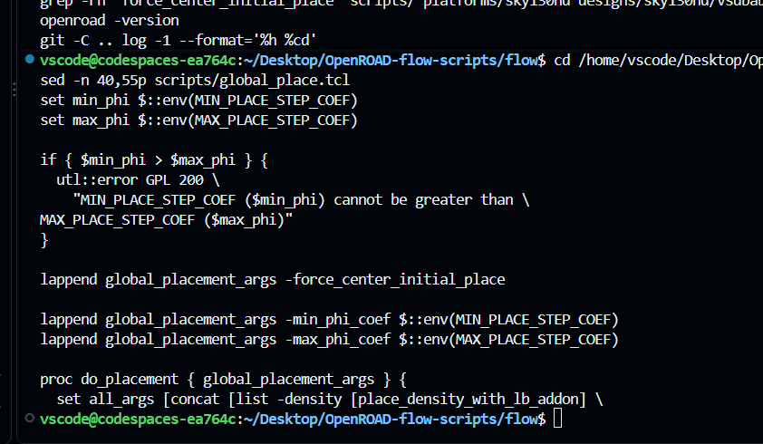
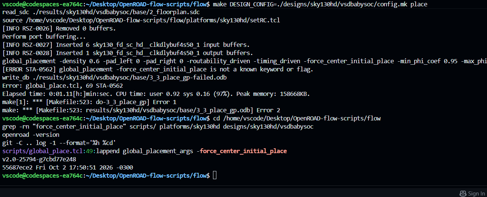
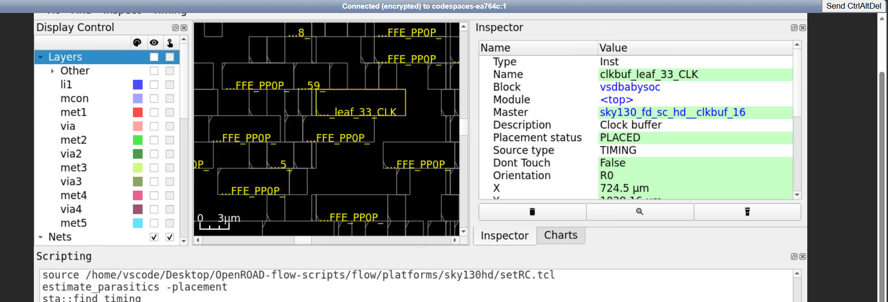
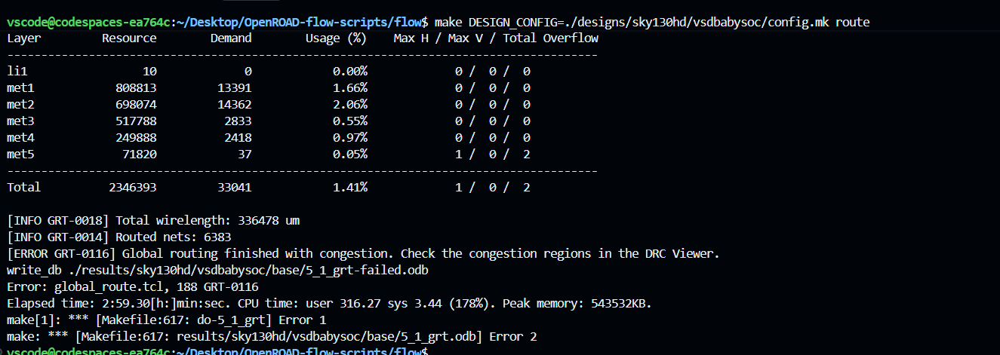
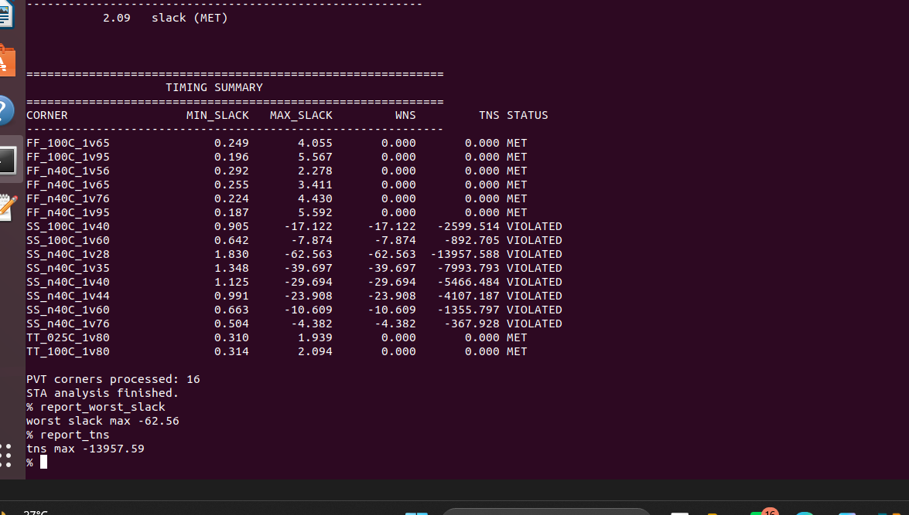
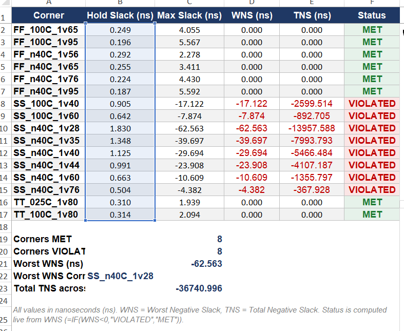
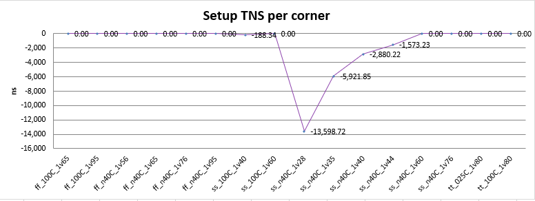
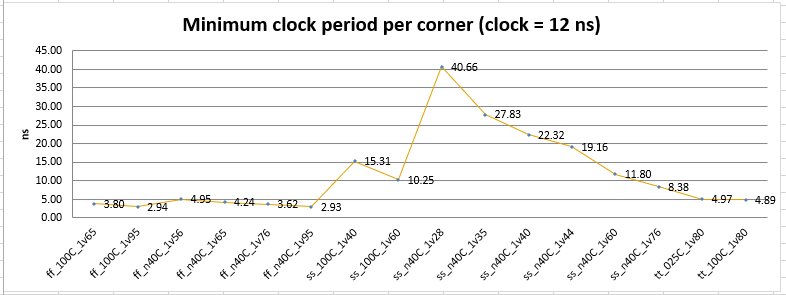

# VSDBabySoC OpenROAD — Visual Evidence (Continuation)

This file continues the project documentation with the relevant screenshots from the OpenROAD session. It adds visual evidence and captions only; it does not repeat the earlier README's project overview, commands, or general explanations.

## Floorplan and layout inspection

The GUI screenshot shows the VSDBabySoC floorplan and the design objects inspected during the physical-design flow.


## Global placement: error observed

The placement run stops because the installed OpenROAD executable does not recognize the `-force_center_initial_place` option. This screenshot records the error reported by the terminal.



The related script excerpt shows the option being appended to the global-placement arguments. Confirm the installed OpenROAD command syntax/version compatibility before editing this setting.



## Timing report

The OpenROAD timing panel displays setup-path information and slack values for the inspected stage. Treat these as the values visible in this run; consult the full reports for final sign-off.


## Clock-tree synthesis and clock buffers

The following views show clock-tree/clock-buffer instances after CTS, including placement details visible in the OpenROAD inspector.




## Power-density heat map

The heat-map view provides a visual representation of power-density distribution across the design. It is included as a GUI observation, not as an independent sign-off result.


## Global routing: congestion observed

The global-routing terminal output reports congestion and indicates that the routing stage did not finish cleanly. Review the congestion regions in the GUI/DRC viewer and rerun routing after addressing the cause.


The additional terminal excerpt records timing-related results from the later flow stage.



## Notes

- The screenshots are retained as supplied, with descriptive filenames for easier reference.
- A screenshot demonstrates what was displayed in that session; it does not by itself prove that a stage completed successfully.
- The placement-option error and global-routing congestion shown above remain items to resolve before claiming a fully successful end-to-end physical-design run.

## RTL synthesis: theory, netlist, and synthesis report

**Synthesis** converts the RTL description into a technology-mapped gate-level netlist using the target standard-cell library and the constraints supplied to the synthesis flow. During this process, the tool elaborates the design, performs logic optimization, and maps the optimized logic to available library cells. Synthesis results provide an early view of cell usage and estimated area; they do not prove that the design will meet timing after placement and routing.

### What to check in the synthesis results

- **Mapped cell count:** the supplied project checklist records **539 cells** for synthesis. Treat this as the reported count from that run and confirm the synthesis log/report if a detailed breakdown is needed.
- **Cell area:** the supplied `synth_stat.txt` screenshot shows a reported chip area of **53019.600000** (tool-reported area units). It also reports **22901.964800** for sequential elements, or **43.20%** of the reported chip area.
- **Library cells with unknown area:** the screenshot says the area for `\avsdpll` and `\avsddac` is unknown. These macro area values are therefore not fully represented by the displayed standard-cell area total; confirm how the flow accounts for these macros before comparing area totals.
- **Netlist and constraints:** verify the generated mapped netlist and the timing constraints (SDC) used for the run. The netlist is the input to later physical-design stages.
- **Warnings and errors:** review synthesis logs for unresolved modules, inferred latches, unconstrained paths, missing library cells, or other warnings that may affect the result.

### Synthesis report evidence and location

The terminal screenshot shows this command being used to inspect synthesis statistics:

```bash
cat reports/sky130hd/vsdbabysoc/base/synth_stat.txt
```

It also shows report files such as `2_floorplan_final.rpt`, `3_detailed_place.rpt`, and `4_cts_final.rpt` being inspected later in the flow. Those are physical-design-stage reports, not the synthesis statistics report. To find the synthesis artifacts available in your run, use:

```bash
find reports/sky130hd/vsdbabysoc/base -maxdepth 1 -type f -print | sort
find results/sky130hd/vsdbabysoc/base -maxdepth 1 -type f -print | sort
```

The exact mapped-netlist filename depends on the configured flow. Confirm the artifact and log names from the files actually present; do not assume a filename that is not listed.

### Synthesis versus post-synthesis STA

Synthesis reports describe the mapped logic, cell counts, and area estimates. **Post-synthesis STA** is a separate timing-analysis step that evaluates the synthesized netlist against clock and I/O constraints. The two reports answer different questions: synthesis asks what hardware was mapped, while STA asks whether constrained timing paths meet their timing requirements under the analyzed delay model.


## Static Timing Analysis (STA): theory and required reports

STA checks whether signals can propagate through the design within the timing requirements defined by the clock and input/output constraints. It analyzes timing paths without running functional simulation. The key results include setup slack, hold slack, worst negative slack (WNS), and total negative slack (TNS).

### Post-synthesis STA report

**Purpose:** Post-synthesis STA checks the technology-mapped netlist after RTL synthesis. It helps identify timing problems before physical implementation, such as paths that are too slow for the target clock period.

**What it normally evaluates:**
- Register-to-register paths, input-to-register paths, register-to-output paths, and other constrained paths.
- Setup and hold requirements under the available timing constraints.
- Cell-delay estimates and the interconnect assumptions available at this stage. This is not a substitute for final timing using routed parasitics.

**Report supplied:** `reports/Post_Synthesis_STA_Report_11ns_16_Corners.docx` contains the post-synthesis STA results for the synthesized `vsdbabysoc` netlist at an **11 ns clock period** across 16 PVT corners. It includes the terminal summary, a corner-by-corner results table, charts, and the detailed OpenSTA path output. The report uses ideal clock latency because clock-tree synthesis has not yet been applied at this stage.

Headline results from this report:
- **8 of 16 corners meet setup timing; 8 of 16 fail setup timing.**
- **All 16 corners meet hold timing** in the reported run; the hold slack values are positive.
- The worst setup slack is approximately **−62.563 ns** at `SS_n40C_1v28`.
- The report's clock target is 11 ns, so these results must not be compared directly with the separate 12 ns post-route report without accounting for the different constraints and physical timing models.






To locate other report files generated by your particular flow, run this from the `flow` directory:

```bash
find reports/sky130hd/vsdbabysoc/base -maxdepth 1 -type f -print | sort
grep -ilE "slack|Startpoint|Endpoint|Path Group|slack" reports/sky130hd/vsdbabysoc/base/*.rpt
```

Then inspect the synthesis-stage report candidates and confirm that the report corresponds to the synthesized netlist, before floorplanning/placement. The exact filename depends on the flow version and configured report targets; it cannot be confirmed from the screenshots alone.

### Post-routing STA report

**Purpose:** Post-routing STA checks timing after routing, ideally using extracted parasitic resistance and capacitance (SPEF or the equivalent parasitic data produced by the flow). It is used to evaluate timing with a more realistic model of the routed interconnect.

**What it normally evaluates:**
- Setup and hold timing after routing.
- Delay contributed by cells and routed interconnect.
- WNS/TNS and the worst timing paths, to identify whether timing constraints are met after physical implementation.
- The effect of routing parasitics and clock-tree effects on the final timing result.

**Report supplied:** `reports/Post_Route_STA_Report_12ns_16_Corners.docx` is a full post-route STA report for `vsdbabysoc` using the SKY130 HD library, propagated clocks, a **12 ns clock period (83.33 MHz target)**, and 16 PVT corners. The document includes a corner-by-corner discussion, path details, summary tables, charts, warnings, and recommended next steps.

Headline results from this report:
- **11 of 16 corners meet setup timing; 5 of 16 fail setup timing.** The failing cases are the low-voltage slow corners: `ss_100C_1v40` and `ss_n40C_1v28` through `ss_n40C_1v44`.
- **All 16 corners meet hold timing**; the smallest reported hold slack is about **+0.198 ns** at `ff_n40C_1v95`.
- The tightest passing setup corner is `ss_n40C_1v60` at approximately **+0.20 ns** slack; the standard slow corner `ss_100C_1v60` has about **+1.75 ns** setup slack.
- The worst corner is `ss_n40C_1v28`, with about **−28.66 ns** setup slack and an estimated minimum period of **40.66 ns** (about **24.6 MHz**).
- Timing is not the only sign-off condition: the report also identifies max-slew and max-capacitance violations, especially at `ss_n40C_1v60`, and a large slew violation on `dac/D[8]` in low-voltage corners. These should be resolved and the analysis rerun before sign-off.








**Important run-provenance note:** another supplied terminal screenshot shows a global-routing attempt ending with `GRT-0116` congestion, and the placement attempt shown elsewhere rejects `-force_center_initial_place`. The supplied post-route STA document demonstrates that a post-route timing analysis was performed for a run, but it does not by itself prove that the specific failed attempt shown in those screenshots was later repaired. Match report timestamps, netlist, and run directory before treating the full flow as signed off.

For other report files generated by the flow, locate and inspect the final-stage reports with:

```bash
find reports/sky130hd/vsdbabysoc/base -maxdepth 1 -type f -print | sort
grep -ilE "slack|Startpoint|Endpoint|Path Group|slack" reports/sky130hd/vsdbabysoc/base/*.rpt
```

Confirm from the report header and flow stage that it was generated after routing and uses the routed parasitics. Do not label a report “post-routing STA” based only on a filename or positive slack values.

### How to interpret the main STA metrics

| Metric | Meaning | How to read it |
|---|---|---|
| Setup slack | Required arrival time minus actual arrival time for setup checks. | Non-negative slack means the checked setup path meets its requirement. Negative slack indicates a setup violation. |
| Hold slack | Margin for hold-time checks. | Non-negative slack means the checked hold path meets its requirement. Negative slack indicates a hold violation. |
| WNS | Worst negative slack across the analyzed paths/checks, according to the report's convention. | A negative value indicates at least one timing violation; confirm the report's exact definition and path group. |
| TNS | Aggregate negative slack across violating paths. | Zero commonly indicates no negative slack in the covered checks; verify which checks and path groups are included. |
| Clock skew | Difference in clock arrival times at relevant clock points. | Skew affects setup and hold margins; evaluate it with the full timing path, not in isolation. |
| Parasitics | Estimated or extracted wire resistance and capacitance. | Routed/extracted parasitics make post-route timing more representative of physical interconnect. |

### Why the 16-corner STA stage matters

Process, voltage, and temperature (PVT) corners model different operating conditions. Timing may worsen under different combinations of process speed, supply voltage, and temperature. Multi-corner STA checks the design against the configured timing corners and modes rather than relying on one timing result. The checklist calls for **all 16 corners**; retain the per-corner reports or a summary that identifies each corner and whether setup and hold checks pass.

### Report status based on the screenshots currently available

- **Post-synthesis STA:** A full 16-corner report is included. At the 11 ns target, 8 corners meet setup and 8 fail; all corners meet hold in that report.
- **Post-CTS timing:** The screenshot excerpt for `4_cts_final.rpt` shows worst slack `6.04` and setup skew `0.21`. These are stage-specific results, not a substitute for routed timing.
- **Post-route STA:** A full 16-corner report is included for a 12 ns target. Eleven corners meet setup and five fail; all corners meet hold, but electrical violations remain.
- **Run consistency:** the global-routing screenshot shows congestion and the placement screenshot shows an unsupported option. Verify that the post-route report belongs to a later successful run before marking routing and sign-off complete.

## Included full reports

The ZIP contains the full source documents, not just screenshots:

- `reports/Post_Synthesis_STA_Report_11ns_16_Corners.docx` — full post-synthesis multi-corner STA report (11 ns clock).
- `reports/Post_Route_STA_Report_12ns_16_Corners.docx` — full post-route multi-corner STA report (12 ns clock), including corner-level results and recommendations.

These are separate timing runs with different clock targets and timing models. Use each report's own constraints when interpreting its slack numbers.

### Synthesis theory and reported results

Synthesis maps RTL into standard-cell logic. The supplied checklist records **539 cells**. The terminal output excerpt supplied with the project reports a chip-area figure of **53019.600000** in the tool's reported area units, with **22901.964800 (43.20%)** attributed to sequential elements. The same output says the area for `\avsdpll` and `\avsddac` is unknown, so do not interpret the total as a fully characterized physical macro-inclusive area. The raw synthesis statistics can be reviewed with `cat reports/sky130hd/vsdbabysoc/base/synth_stat.txt` from the flow directory.

Synthesis, post-synthesis STA, CTS-stage timing, and post-route STA are different checkpoints: synthesis counts/maps cells; post-synthesis STA checks timing before physical clock-tree and routed-wire effects; CTS timing includes clock-tree effects; post-route STA uses routed parasitic effects and is closer to physical timing sign-off. A positive setup slack alone does not establish sign-off if other corners or electrical checks still fail.

## Project checklist and current progress

This checklist follows the order supplied for the VSDBabySoC project. The first four stages are marked complete according to the provided checklist. Later stages remain in progress until their outputs are verified.

| No. | Stage | Status | Evidence / next action |
|---:|---|---|---|
| 1 | RTL Design | **Done** | Completed, according to the supplied checklist. |
| 2 | Testbench | **Done** | Completed, according to the supplied checklist. |
| 3 | RTL Simulation | **Done** | 521 checks reported in the supplied checklist. |
| 4 | Synthesis | **Done** | 539 cells reported in the supplied checklist. |
| 5 | STA at all 16 corners | **Report available** | Post-synthesis 16-corner STA report supplied; 8 setup corners fail at the 11 ns target. Review/resolve violations. |
| 6 | Floorplan | **PD step** | Inspect and verify the floorplan-stage outputs. |
| 7 | Placement | **PD step** | Resolve the unsupported `-force_center_initial_place` option seen in the placement log, rerun placement, and verify the result. |
| 8 | CTS | **PD step** | Verify the CTS run and its reports; screenshots show clock buffers and timing information, but final outputs should be checked. |
| 9 | Routing | **PD step** | Resolve the global-routing congestion reported as `GRT-0116`, rerun routing, and verify completion. |
| 10 | RC Extraction | **PD step** | Run and verify parasitic resistance/capacitance extraction. |
| 11 | Post-layout STA | **Report available; verify run** | A 16-corner post-route STA report is supplied at 12 ns; 5 setup corners fail and electrical violations remain. Confirm it matches the final routed database. |
| 12 | DRC + LVS | **PD signoff** | Run design-rule checking and layout-versus-schematic checks; record the final results. |
| 13 | GDS | **Final file** | Generate and verify the final GDS file after required checks pass. |

### Progress rules

- Mark a stage **Done** only after its command completes successfully and its output/report has been checked.
- Keep failed attempts documented; do not treat a GUI screenshot alone as proof that the stage completed successfully.
- The supplied terminal screenshots show a placement-option error and global-routing congestion. These issues must be resolved before the physical-design flow can be considered complete.
- Do not describe DRC/LVS signoff or GDS generation as complete until their results/files have been verified.

### Immediate next action

First, reconcile the supplied STA reports with the exact OpenROAD run directory and confirm whether the placement-option and global-routing errors were fixed in a later run. Then resolve setup/electrical violations as required, rerun the affected stages, and only mark routing, RC extraction, DRC/LVS, or GDS complete when their own logs and output files confirm success. The full STA source reports are included under `reports/` in this package.
