# VSDBabySoC OpenROAD — Physical Design Documentation (Continuation)

This document continues the earlier README and adds the implementation stages, screenshot evidence, commands visible in the supplied terminal captures, and the complete STA source reports. The stage order below follows the supplied project checklist. Evidence is described as shown; a screenshot of an attempted run is not treated as proof that the stage passed.


## 1. RTL design, testbench, and RTL simulation

RTL design describes the intended digital behavior using Verilog/SystemVerilog. The testbench applies stimulus to the design and checks outputs against expected behavior. RTL simulation validates functional behavior before synthesis and physical implementation. The supplied checklist records RTL design and testbench as done, and RTL simulation as done with 521 checks. The screenshots in this set do not expose the complete RTL source or the full simulation transcript, so those counts are recorded from the supplied checklist rather than independently reconstructed.

## 2. Synthesis — theory, result, and evidence

Synthesis transforms RTL into a technology-mapped gate-level netlist. It elaborates the hierarchy, optimizes Boolean logic, and maps logic to cells in the selected standard-cell library. Synthesis reports typically include mapped cell counts and estimated area. This stage does not by itself establish that placement, routing, or timing signoff will pass.

The supplied checklist records **539 cells**. The terminal screenshot of `synth_stat.txt` shows:

- Chip area for `vsdbabysoc`: **53019.600000** (the tool's reported area units).
- Area attributed to sequential elements: **22901.964800**, reported as **43.20%** of the chip area.
- Area for `\avsdpll` and `\avsddac` is reported as unknown, so interpret the displayed total with that limitation in mind.


### Commands shown for inspecting synthesis and reports

The following commands are visible in the supplied terminal captures. Run them from the flow directory shown in the screenshots:

```bash
cd /home/vscode/Desktop/OpenROAD-flow-scripts/flow
ls reports/sky130hd/vsdbabysoc/base/
cat reports/sky130hd/vsdbabysoc/base/synth_stat.txt
cat reports/sky130hd/vsdbabysoc/base/2_floorplan_final.rpt
cat reports/sky130hd/vsdbabysoc/base/3_detailed_place.rpt
```

The screenshots show report inspection commands, not a full synthesis invocation, so no unshown synthesis command is claimed here. Useful file-discovery commands (additional diagnostic suggestions, not commands proven to have been run in the screenshots) are:

```bash
find reports/sky130hd/vsdbabysoc/base -maxdepth 1 -type f -print | sort
find results/sky130hd/vsdbabysoc/base -maxdepth 1 -type f -print | sort
```

## 3. Static Timing Analysis at 16 corners

Static timing analysis (STA) evaluates constrained timing paths without running functional simulation. Setup checks test whether data arrives early enough before the capture edge; hold checks test whether data remains stable long enough after the edge. Process/voltage/temperature (PVT) corners model different operating conditions. Multi-corner analysis helps identify conditions under which timing degrades.

### 3.1 Post-synthesis STA

The supplied full report, `reports/STA_REPORT_ASSESSMENTwithgraphs_FULL.docx`, covers the synthesized `vsdbabysoc` netlist at an **11 ns clock target** across 16 PVT corners. It includes theory, corner summary, charts, and detailed OpenSTA path output. As this is pre-physical implementation timing, it should not be treated as routed timing signoff.

Report summary: **8 of 16 corners meet setup and 8 fail setup** in the supplied report; all 16 corners meet hold in that run. The worst setup slack is approximately **−62.563 ns** at `SS_n40C_1v28`. These figures are from the supplied report and its 11 ns constraint.


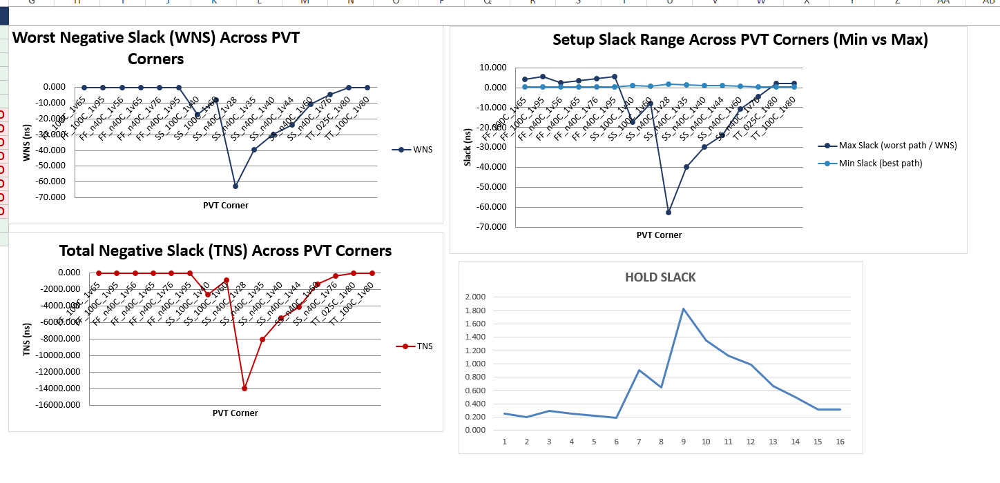

### 3.2 Post-route STA

The supplied full report, `reports/Post_Route_STA_Report_vsdbabysoc_FULL.docx`, covers a **12 ns clock target** and 16 PVT corners, with routed-stage timing context and detailed path output. Post-route STA is intended to account for the physical implementation and routed interconnect parasitics used by that run. Verify the report's provenance against the exact final routed database before using it for signoff.

Report summary: **11 of 16 corners meet setup and 5 fail setup**; all 16 corners meet hold in the supplied report. The worst setup corner is reported as `ss_n40C_1v28`, with approximately **−28.66 ns** setup slack. The report also identifies max-slew/max-capacitance violations, so the design is not fully signed off on the basis of timing alone.

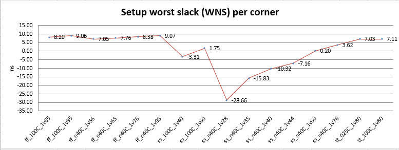


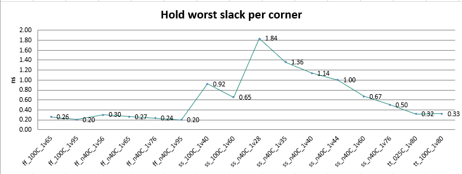

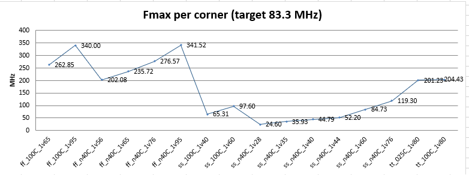


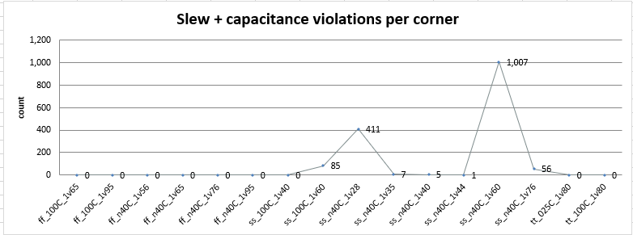

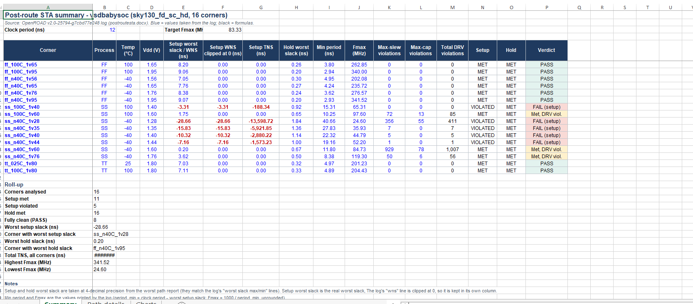

### 3.3 Interpreting STA metrics

- **Setup slack:** non-negative means the checked setup path meets its requirement; negative means a setup violation.
- **Hold slack:** non-negative means the checked hold path meets its requirement; negative means a hold violation.
- **WNS:** worst slack according to the report's definition and covered checks.
- **TNS:** aggregate negative slack across violating paths/checks included by the report.
- **PVT corner:** a specific process, voltage, and temperature combination.
- **Parasitics:** wire resistance and capacitance estimates/extraction used to model interconnect delay.

The 11 ns post-synthesis and 12 ns post-route results use different clock targets and physical timing models; their slack values should not be compared as if they were the same run.

## 4. Floorplan

Floorplanning establishes the core/die region and initial physical organization of the design. It considers macro placement, pin placement, power distribution planning, and available space for standard cells and routing. The supplied OpenROAD GUI screenshot shows the floorplan and design objects; this is evidence of inspection, not a complete floorplan signoff result.


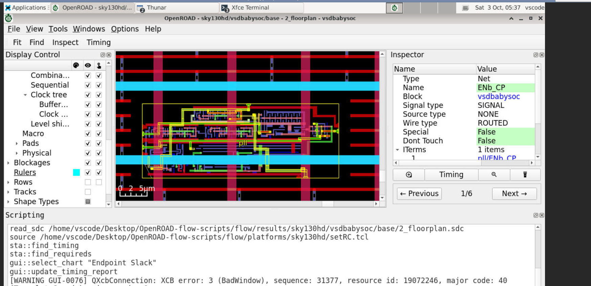

The terminal screenshots show `2_floorplan.sdc` being read by later stages and report inspection for `2_floorplan_final.rpt`. Example command shown:

```bash
cat reports/sky130hd/vsdbabysoc/base/2_floorplan_final.rpt
```

## 5. Placement

Placement assigns standard cells to legal physical locations. Global placement estimates broad locations while optimizing timing, congestion, and wirelength; detailed placement legalizes and refines cell positions. The captured run was invoked with `make ... place` and stopped at global placement because the installed OpenROAD version did not recognize `-force_center_initial_place`.


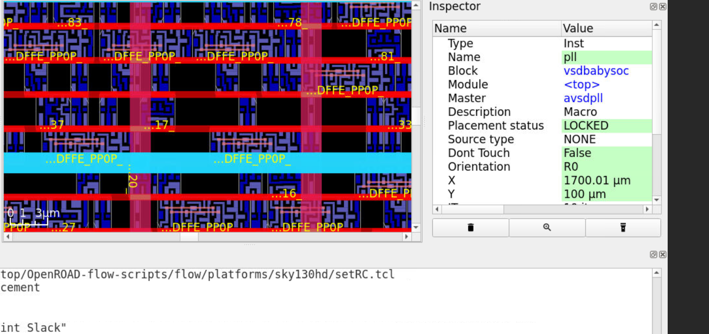

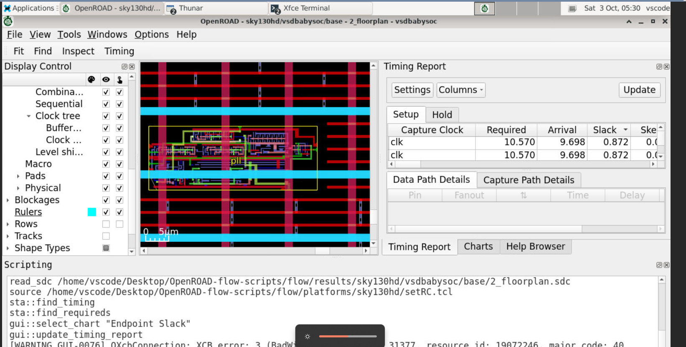

### Commands captured for placement debugging

```bash
cd /home/vscode/Desktop/OpenROAD-flow-scripts/flow
make DESIGN_CONFIG=./designs/sky130hd/vsdbabysoc/config.mk place
sed -n '40,55p' scripts/global_place.tcl
grep -rn "force_center_initial_place" scripts/ platforms/sky130hd designs/sky130hd/vsdbabysoc
openroad -version
git -C .. log -1 --format="%h %cd"
```

The screenshot shows `scripts/global_place.tcl` appending `-force_center_initial_place` to `global_placement_args`; OpenROAD then reports `STA-0562` because that option is not recognized. The screenshot alone does not establish the correct replacement option for this exact installed build. Check the installed tool's help/version and compatible flow scripts, then rerun placement and verify the generated `.odb` and reports.

## 6. Clock-tree synthesis (CTS)

CTS builds a clock distribution network to deliver the clock to sequential elements while controlling insertion delay and skew. It inserts clock buffers/inverters and may resize or adjust cells to meet clock constraints. The supplied GUI screenshots show clock-buffer instances and clock-tree details, and a timing panel with setup slack values. The terminal/report evidence includes `4_cts_final.rpt`, where the captured text reports worst slack max **6.04** and setup skew **0.21** for that stage. These values are stage-specific and do not override the supplied post-route report.


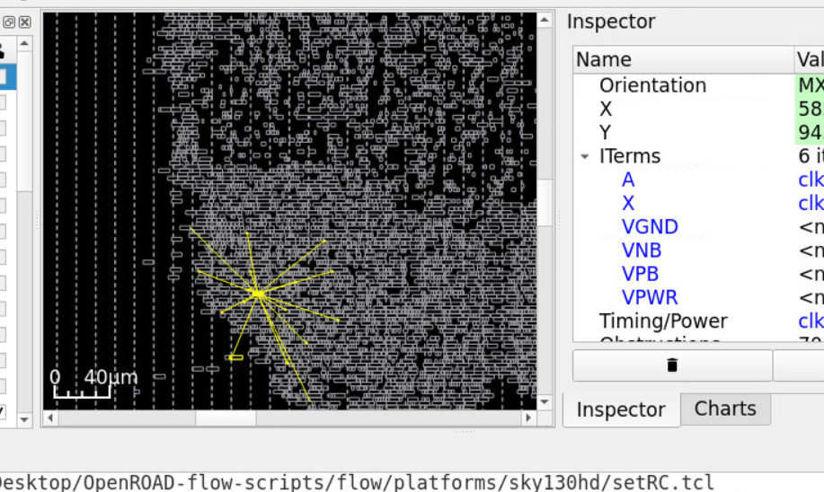

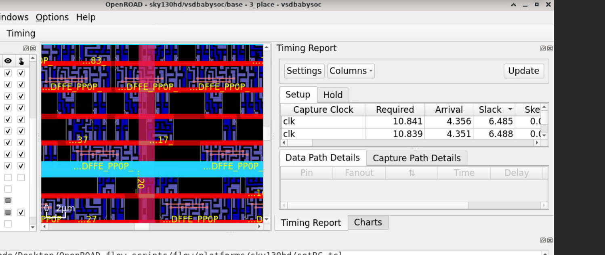


Captured report-inspection command:

```bash
cat reports/sky130hd/vsdbabysoc/base/4_cts_final.rpt
```

## 7. Routing

Routing connects placed cells using the available metal layers and vias while respecting design rules and routing resources. Global routing estimates routing paths and resource usage; detailed routing creates geometrically legal wires and vias. The captured `make ... route` command reports a global-routing congestion error `GRT-0116`. The shown resource summary reports total wirelength **336478 µm** and **6383 routed nets** at that point, but the tool explicitly says global routing finished with congestion, so this is not a successful routing signoff result.

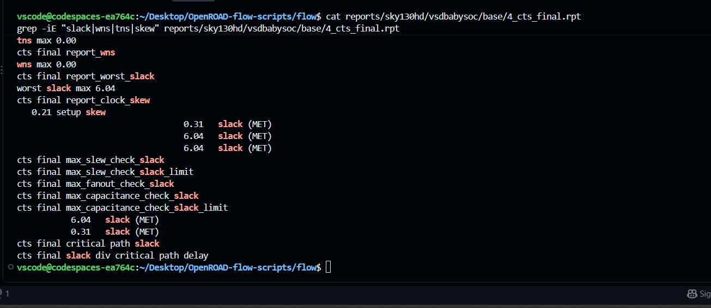

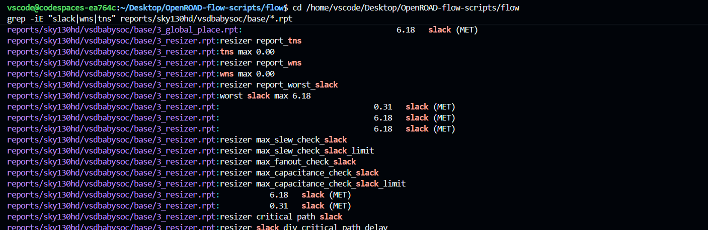

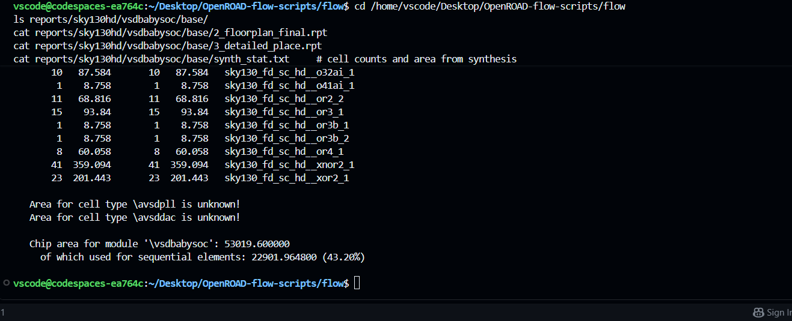


Captured command:

```bash
cd /home/vscode/Desktop/OpenROAD-flow-scripts/flow
make DESIGN_CONFIG=./designs/sky130hd/vsdbabysoc/config.mk route
```

The terminal shows output including `write_db ./results/sky130hd/vsdbabysoc/base/5_1_grt-failed.odb` and `Error: global_route.tcl, 188 GRT-0116`. The next step is to inspect congestion in the DRC/congestion viewer, resolve the cause, rerun routing, and confirm the flow completes without a routing error.

## 8. RC extraction

RC extraction estimates or extracts interconnect resistance and capacitance from the physical layout. These parasitics are used for more realistic delay calculations in post-route timing analysis. The screenshots show `source .../platforms/sky130hd/setRC.tcl` and `estimate_parasitics -placement` in a CTS/placement-stage GUI session. This is placement-based parasitic estimation, not proof that final routed RC extraction completed.

Commands visible in the GUI scripting pane:

```tcl
source /home/vscode/Desktop/OpenROAD-flow-scripts/flow/platforms/sky130hd/setRC.tcl
estimate_parasitics -placement
sta::find_timing
sta::find_requireds
```


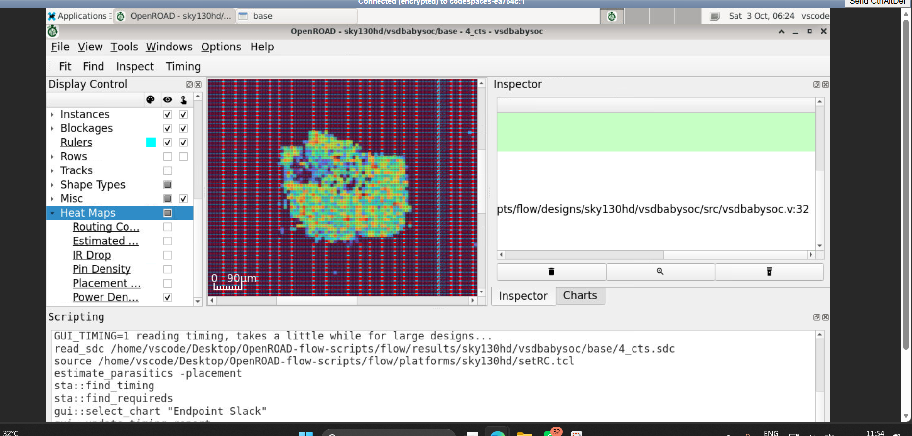

The heat map is a visual inspection artifact; it is not itself an RC extraction report. Confirm the final extracted parasitic file and the timing script's use of that file before claiming RC extraction complete.

## 9. Post-layout STA

Post-layout STA checks setup and hold after physical implementation using the timing model and parasitics associated with that run. The supplied post-route report is included in full under `reports/`. Its report findings are summarized in Section 3.2. Since the screenshots also show a failed placement attempt and global-routing congestion, match the STA report to the exact run directory and final routed database before treating it as final signoff.

## 10. DRC and LVS

Design-rule checking (DRC) verifies that layout geometry complies with manufacturing rules. Layout-versus-schematic (LVS) checks whether the extracted layout connectivity matches the intended netlist. Both are signoff checks distinct from STA. No successful DRC/LVS completion log or clean signoff summary was visible in the supplied screenshots, so these stages remain unverified.

## 11. GDS generation

GDSII is the layout exchange file delivered for fabrication handoff. It should be generated only after required physical-design checks and signoff are complete. No verified final GDS output is visible in the supplied screenshots; therefore this README does not claim that GDS generation is complete.

## Terminal commands collected from the supplied screenshots

These are the command lines legible in the screenshots, grouped by purpose. Paths assume the same environment shown in the terminal captures.

### Enter the flow directory and inspect reports

```bash
cd /home/vscode/Desktop/OpenROAD-flow-scripts/flow
ls reports/sky130hd/vsdbabysoc/base/
cat reports/sky130hd/vsdbabysoc/base/2_floorplan_final.rpt
cat reports/sky130hd/vsdbabysoc/base/3_detailed_place.rpt
cat reports/sky130hd/vsdbabysoc/base/synth_stat.txt
cat reports/sky130hd/vsdbabysoc/base/4_cts_final.rpt
```

### Inspect slack and timing reports

```bash
grep -iE "slack|wns|tns|skew" reports/sky130hd/vsdbabysoc/base/*.rpt
```

### Placement debug

```bash
make DESIGN_CONFIG=./designs/sky130hd/vsdbabysoc/config.mk place
sed -n '40,55p' scripts/global_place.tcl
grep -rn "force_center_initial_place" scripts/ platforms/sky130hd designs/sky130hd/vsdbabysoc
openroad -version
git -C .. log -1 --format="%h %cd"
```

### Routing attempt

```bash
make DESIGN_CONFIG=./designs/sky130hd/vsdbabysoc/config.mk route
```

The command list above separates commands visible in the screenshots from explanatory suggestions. The captured placement and routing attempts ended with errors; rerunning a command is not sufficient by itself—check its exit status and the expected output files.

## Full report files included

- `reports/STA_REPORT_ASSESSMENTwithgraphs_FULL.docx` — original complete post-synthesis/multi-corner STA report, including its graphs and detailed analysis.
- `reports/Post_Route_STA_Report_vsdbabysoc_FULL.docx` — original complete post-route/multi-corner STA report, including its graphs and detailed analysis.
- `reports/Post_Synthesis_STA_Report_11ns_16_Corners.docx` and `reports/Post_Route_STA_Report_12ns_16_Corners.docx` — clearly named copies retained from the prior package for convenient identification.

The checklist is placed at the beginning of this continuation, in the requested stage order; it is intentionally not repeated at the end.
