# Lithium Battery Pack Failure Prevention for Portable Devices Using Debounced Fault Latching

**Design name:** `battery_protect`  |  **Flow:** RTL to GDS on sky130 (`sky130_fd_sc_hd`)

A small digital protection controller that keeps the lithium battery pack in a portable device from failing, taken from Verilog all the way to a DRC-clean, LVS-clean GDS layout using only `sky130_fd_sc_hd` standard cells.

## What this project is

A lithium battery pack in a portable device must be disconnected quickly when something goes wrong: too much voltage while charging, too little voltage while discharging, or too much current in either direction. `battery_protect` is the digital block that makes that decision. It watches four fault flags (`ov`, `uv`, `occ`, `ocd`), ignores brief noise by debouncing each flag, latches a real fault, and drives two MOSFET enables that cut the charge path, the discharge path, or both. A latched fault is released only by a `clear` once the fault condition has actually gone away.

The project constraints are: strictly `sky130_fd_sc_hd` cells (no macros, memory, pads or analog), a sequential design, a 100 x 100 um die, and a final area under about 5,500 um^2, with simulation, area, timing and physical-design feasibility all shown, and STA run on every library corner.

## What we are going to do

1. **Design** the RTL: a `debounce` module and the top level (section 1, Appendix A).
2. **Verify** the RTL with one self-checking testbench that exercises normal operation, noise, each fault, recovery and reset (section 3, Appendix B).
3. **Verify the gate-level netlist** with the same testbench, and compare RTL and gate-level behaviour clock by clock (section 4).
4. **Synthesize** and record the cell count and area (section 5).
5. **Time it** with static timing analysis at all 16 library corners, before layout and after routing (section 6).
6. **Build the layout** in OpenLane: floorplan, placement, clock tree, routing, parasitic extraction (section 7).
7. **Sign off** with DRC, LVS and antenna checks, and look at the final layout (section 8).

Section 10 lists every command used, so each result can be reproduced.

## Results at a glance

| Item | Result |
|---|---|
| Design | 16 signal pins, 26 flip-flops, async active-low reset, 10 ns clock |
| RTL and gate-level simulation | Both print `PASS`, and the per-clock logs are identical (559 lines each) |
| Cells after synthesis | 120 (26 flip-flops, 94 combinational) |
| Synthesis area | 1347.54 um^2, about 24.5 percent of the 5,500 um^2 limit |
| Die | 100 x 100 um, placement utilization 18 percent |
| Physical signoff (run `final2`) | DRC 0 violations, LVS 0 errors, antenna 0 violations |
| Post-route STA | 12 of 16 corners meet timing, including every corner at or above 1.60 V. The four failures are the cold slow corners at 1.28 to 1.44 V |
| Deliverable | `battery_protect.gds`, produced by the `final2` run (see section 8 for where to find it) |

---

## 1. The design in one page

Module `battery_protect`, 16 signal pins (plus power):

| Pin | Dir | Meaning |
|---|---|---|
| `clk` | in | clock |
| `rst_n` | in | asynchronous, active-low reset |
| `ov` | in | over-voltage flag (raw comparator output, active high) |
| `uv` | in | under-voltage flag |
| `occ` | in | over-current on charge flag |
| `ocd` | in | over-current on discharge flag |
| `tick` | in | debounce time base: counters advance only on clocks where `tick` = 1 |
| `clear` | in | releases latched faults whose raw flag is gone |
| `dbn_sel[1:0]` | in | selects the debounce length |
| `chg_en` | out | charge MOSFET enable |
| `dsg_en` | out | discharge MOSFET enable |
| `fault[3:0]` | out | latched faults, `{ocd, occ, uv, ov}` |

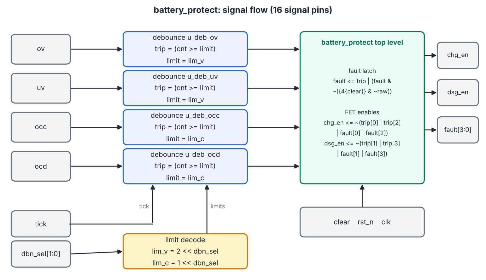

*Figure 1. Signal flow: four debouncers feed one fault latch and the two FET enables. `dbn_sel` is decoded into two limits shared by all four counters.*

Behaviour:

- Each of the four flags goes through its own `debounce` module (5-bit counter).
  `trip = (cnt >= limit)`. The counter counts only when `tick` = 1, restarts from 0
  on any clock where the flag is low, and stops once the limit is reached.
- Limits by `dbn_sel`:

  | `dbn_sel` | ov / uv ticks | occ / ocd ticks |
  |---|---|---|
  | 00 | 2 | 1 |
  | 01 | 4 | 2 |
  | 10 | 8 | 4 |
  | 11 | 16 | 8 |

- A fault is set when its debounce trips and stays latched. It is released only by
  `clear` while that fault's raw flag is low:
  `fault <= trip | (fault & ~({4{clear}} & ~raw))`.
- `ov` and `occ` cut charge. `uv` and `ocd` cut discharge:
  `chg_en <= ~(trip[0] | trip[2] | fault[0] | fault[2])`,
  `dsg_en <= ~(trip[1] | trip[3] | fault[1] | fault[3])`.
- Both enables are 0 in reset and during the first clock after reset.
- `chg_en` and `dsg_en` lag the fault bits by one clock, because they are registered
  from the previous `fault`.
- All inputs are assumed synchronous to `clk`. There are no synchronizers.

Timing facts the testbench depends on (let `n` be the limit):

- A flag held high for exactly `n` rising edges with `tick` high makes the counter reach `n`,
  so `trip` goes high right after edge `n`.
- `fault` captures `trip` on edge `n+1`, and `chg_en`/`dsg_en` drop on that same edge.
- So the cut shows up one clock after the pulse ends. That is why the testbench
  waits one or two clocks before checking.

### Module walkthrough

**Big picture.** Each of the four raw flags (`ov`, `uv`, `occ`, `ocd`) goes through its own debouncer. The debouncers' trip outputs feed one latch that drives `fault[3:0]`. The same trips and latched faults then decide the two MOSFET enables.

**`debounce`: a counter that must reach a limit.**

```verilog
assign trip = (cnt >= limit);
always @(posedge clk or negedge rst_n)
    if (!rst_n)             cnt <= 0;
    else if (!in)           cnt <= 0;
    else if (tick && !trip) cnt <= cnt + 1;
```

- `trip` is combinational. It goes high as soon as the counter reaches the limit, with no extra clock.
- A low flag restarts the count. It resets the counter on any clock, even when `tick` is low. That is the glitch filter: the flag must stay high for `limit` ticks in a row.
- `tick` is the slow time base. The counter advances only on clocks where `tick` is 1. A clock with `tick` low and the flag still high neither counts nor restarts, it just holds.
- The counter stops at the limit. `!trip` blocks further increments, so `cnt` never passes the limit and `trip` stays high while the flag stays high. The largest limit is 16, which fits the 5-bit counter.
- Timing with `limit = 4` and `tick` high every clock: the flag is sampled high on edges 1 to 4, so `cnt` goes 1, 2, 3, 4 and `trip` rises right after edge 4. When the flag drops, the next edge clears `cnt`, so `trip` falls one clock after the flag does.

**Top level.**

- **Limits from `dbn_sel`.** `lim_v = 5'd2 << dbn_sel` gives 2, 4, 8, 16 for ov and uv. `lim_c = 5'd1 << dbn_sel` gives 1, 2, 4, 8 for occ and ocd. Over-current trips twice as fast as the voltage faults.
- **Bit order.** `trip` and `raw` are both `{ocd, occ, uv, ov}`, so bit 0 is ov and bit 3 is ocd. That is the same order as `fault`.
- **Fault latch.** The line `fault <= trip | (fault & ~({4{clear}} & ~raw));` works per bit. If that bit's trip is 1, the fault is set or stays set, and `clear` is overridden. If its trip is 0, the fault holds its old value unless `clear` is high and that flag's raw input is low, and only then does it release. Clearing while the flag is still high does nothing: the raw flag blocks `clear`, and the still-high trip would re-set the fault anyway.
- **Why the testbench holds `clear` for 3 clocks.** `trip` stays high for one clock after the flag drops. A one-clock `clear` landing on exactly that clock would be overridden, so a short `clear` can be swallowed.
- **Enables.** `chg_en <= ~(trip[0] | trip[2] | fault[0] | fault[2])`, so ov and occ cut charge. `dsg_en` is the same with bits 1 and 3, so uv and ocd cut discharge. Because the enables use `trip` as well as `fault`, the cut happens on the same clock the fault latches (CYC 33 in Figure 2). They read the old `fault`, so the enable comes back one clock after the fault clears (CYC 44 to 45).
- **Reset.** Async and active-low, with both enables 0 and all faults cleared. The first clock after release computes the enables as 1.
- **Size.** 26 flops: 20 counter bits (4 x 5), 4 fault bits and the two enables.
- **Assumptions.** Inputs are synchronous to `clk` with no synchronizers. Reset asserts asynchronously and releases without synchronization.

---

## 2. Files

| File | Purpose |
|---|---|
| `battery_protect.v` | RTL: `debounce` and `battery_protect` in one file |
| `tb_battery_protect.v` | the delayed, self-checking testbench used for both RTL and GLS (a copy of `tb_battery_protect_compare.v`) |
| `battery_protect_net.v` | flattened gate-level netlist from the standalone Yosys run |
| `battery_protect.sdc` | timing constraints |
| `config.tcl` | OpenLane configuration |
| `sta_corner.tcl`, `sta_post.tcl` | OpenSTA scripts for pre-layout and post-route |
| `sta_summary.txt`, `sta_post_final2_summary.txt` | per-corner result tables |

The complete RTL, testbench and SDC are reproduced in full in Appendices A, B and C at the end of this README.

---

## 3. The testbench, in detail

### 3.1 Goals

One file, `tb_battery_protect.v`, must do three jobs:

1. Check the design against its specification with self-checking assertions
   (prints `PASS` or `FAIL (n errors)` at the end).
2. Run unchanged on the RTL **and** on the gate-level netlist, using only the 16 top-level pins.
3. Produce a per-clock text log so RTL and GLS behaviour can be compared exactly with `diff`.

### 3.2 Structure

```
tb_battery_protect
 |- clock generator (10 ns period)
 |- Part A signals + standalone debounce instance      (RTL only, not under -DGLS)
 |- Part B signals + battery_protect instance (dut)
 |- tick generator (tdiv counter + tick_fast mode)
 |- watch / cut_seen monitor
 |- $monitor and per-clock CYC logger
 |- helper tasks: check, wait_cycles, pulse, do_clear, all_ok
 |- main initial block: Part A tests (RTL only), Part B tests B1..B15
 |- timeout watchdog (400000 ns)
```

### 3.3 Compile-time switches

| Switch | Effect |
|---|---|
| `-DGLS` | Skips Part A. A flattened netlist has no `debounce` module, so the standalone instance can't compile. |
| `-DFUNCTIONAL` | Tells the sky130 Verilog models to use functional (no specify block) behaviour. |
| `-DUNIT_DELAY=#1` | Gives every sky130 cell output a 1 ns delay, so GLS has realistic ordering. Without it, zero-delay GLS can race at clock edges. |

The `SETTLE` macro adapts the sampling delay to the mode:

```verilog
`ifdef GLS
    `define SETTLE #4      // let 1 ns-per-cell delays ripple through before sampling
`else
    `define SETTLE #1
`endif
```

A few gates deep, the netlist needs up to a few ns after a clock edge for every output to
settle, so GLS samples 4 ns after the edge, still well inside the 5 ns half-period.

### 3.4 Clock, tick and signals

- `always #5 clk = ~clk;` gives a 10 ns period. Rising edges are at 5, 15, 25 ns, and so on.
- Part B inputs `ov, uv, occ, ocd, clear` start at 0. `rst_n` starts at 1 so that
  asserting it later is a real falling edge (important for the asynchronous reset).
- `dbn_sel` starts at `01`, so `vt = 4` (ov/uv limit) and `ct = 2` (occ/ocd limit).
- `tick` is generated from two things: `tick = tick_fast | (tdiv == 0)`.
  - `tick_fast = 1`: `tick` is high every clock (fast debounce, used by most tests).
  - `tick_fast = 0`: `tick` is high one clock in four. Used by test B14 to prove the debounce counts
    ticks, not clocks.
  - `tdiv` is a 2-bit divider that **resets with `rst_n`**. This matters for RTL-vs-GLS
    comparison: both runs then restart the divider phase at every reset, so `tick` lines up.

### 3.5 Monitors and logs

- **`watch` / `cut_seen`**: a flag the tests turn on around glitch tests. On every rising
  edge while `watch = 1`, if either enable is 0, `cut_seen` latches to 1. Tests then assert
  `cut_seen === 0`, which proves a short pulse never caused even a momentary cut-off.
- **`$monitor`**: prints a line whenever any watched signal changes. Handy for a first look.
- **`CYC` logger**: the key comparison tool. It starts at the first falling edge of `rst_n`,
  and on every falling clock edge waits 3 ns (so, 8 ns after the previous rising edge),
  then prints one line:

  ```
  CYC 17 rst=1 ov=0 uv=0 occ=0 ocd=0 clr=0 sel=01 tick=1 | chg=1 dsg=1 flt=0000
  ```

  8 ns after the rising edge, every input driven by the testbench and every gate-level output has settled,
  so RTL and GLS print identical lines if they behave the same.
  An earlier version sampled too early. It showed a one-line difference at CYC 556 (`fault`
  still `1001` 1 ns after an async reset in GLS), which is why the sample was moved later.

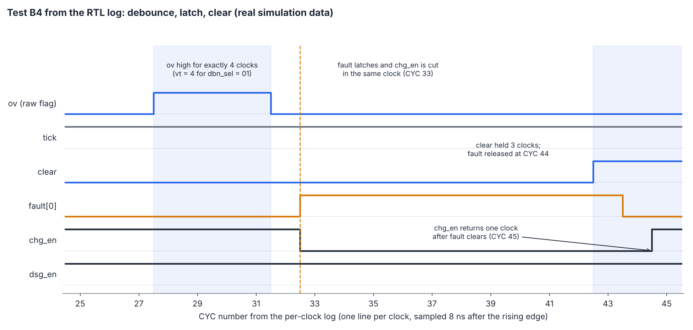

*Figure 2. Test B4 drawn from the real RTL `CYC` log (CYC 25 to 45). `ov` is high for exactly 4 clocks, `fault[0]` latches and `chg_en` drops
at CYC 33, `clear` is held for 3 clocks, `fault[0]` clears at CYC 44, and `chg_en` comes back one clock later at CYC 45.*

### 3.6 Helper tasks

| Task | What it does |
|---|---|
| `check(cond, msg)` | If `cond` is false: increments `errors` and prints `FAIL @time: msg`. |
| `wait_cycles(n)` | `repeat (n) @(posedge clk); SETTLE;`: waits `n` rising edges, then lets outputs settle. All checks happen after this. |
| `pulse(mask, n)` | Drives flags `{ocd, occ, uv, ov} = mask` high for `n` clocks, then drops all four. |
| `do_clear` | `clear = 1` for 3 clocks, then 0. Three clocks cover the one-clock lag of the enables. |
| `all_ok(tag)` | Checks `chg_en = 1`, `dsg_en = 1` and `fault = 0000`. |

Because `pulse` sets the flag just after one edge and `wait_cycles(n)` waits `n` edges,
the flag is sampled high on exactly `n` rising edges. That is how "exactly the limit" and
"limit minus one" are tested precisely.

### 3.7 Part A: standalone `debounce` (RTL only, limit = 4)

| Test | Stimulus | Expected |
|---|---|---|
| A1 | Assert `d_rst_n` low, then release | `trip` = 0 in reset and after release |
| A2 | Input high for `limit-1` = 3 clocks, then low | No trip at any point |
| A3 | Input high for exactly 4 clocks; hold 5 more; drop | Trips after exactly 4, stays while input high, drops when input drops |
| A4 | High 3 clocks, low 1, high 3 | Count restarts, so no trip |
| A5 | `tick` low, input high for 12 clocks; then `tick` high | No counting without tick; trips after 4 ticks |
| A6 | Trip it, then pulse async reset | `trip` goes low immediately, and stays low after release |

### 3.8 Part B: top level (all through the 16 pins, so it also runs on the netlist)

Part B starts on a clock edge (`@(posedge clk); #2 rst_n = 0;`) so RTL and GLS runs
share the same phase relative to the clock.

| Test | What it checks |
|---|---|
| **B1** reset | With `rst_n` low: `chg_en = dsg_en = 0`, `fault = 0000`. |
| **B2** wake-up | After release and 2 clocks: both enables on, no faults. |
| **B3** short glitches | A pulse of `limit-1` on each of ov, uv, occ, ocd never cuts either enable (`cut_seen` stays 0). |
| **B4** OV at the limit | Pulse of exactly `vt` clocks: `fault = 0001`, `chg_en = 0`, `dsg_en = 1`. Stays latched after the flag drops. `clear` releases it. |
| **B5** sustained OV | While `ov` is still high, `clear` is ignored. After `ov` drops it is still latched. `clear` then releases it. |
| **B6** UV | Cuts only `dsg_en`. Same latch, ignore-clear-while-present, and release behaviour. |
| **B7** OCC | Pulse of `ct` clocks cuts only `chg_en`. Latched, then released by `clear`. |
| **B8** OCD | Sustained: cuts only `dsg_en`. `clear` ignored while present, released after. |
| **B9** all four at once | `fault = 1111`, both enables off, still latched after flags drop, `clear` recovers. |
| **B10** split pulses | `vt-1` clocks high, 1 low, `vt-1` high: count restarts, so no trip. |
| **B11** harmless clear | `clear` with no fault changes nothing. |
| **B12** selective release | OV latched with its flag gone, UV latched with its flag still present. One `clear` releases OV only (`fault = 0010`, `chg_en = 1`, `dsg_en = 0`). After UV's flag drops, a second `clear` releases UV. |
| **B13** `dbn_sel` sweep | For `s` = 0..3 (limits 2/4/8/16 and 1/2/4/8): `limit-1` pulses never trip. A pulse of exactly `limit` trips each of the four faults, and `clear` recovers each. At `s` = 0 the occ/ocd limit is 1, so `limit-1` = 0 and that sub-test is skipped. |
| **B14** slow tick | With `tick_fast = 0`: 8 clocks of `ov` is only 2 ticks (needs 4), so no trip. 24 clocks is at least 4 ticks, so it trips. Proves the debounce counts ticks, not clocks. |
| **B15** reset during faults | `ov` and `ocd` latched (`fault = 1001`). Assert `rst_n` low: after `#2`, outputs off and `fault = 0000`. Release one clock later. Outputs return to normal. |

The 2 ns wait in B1 and B15 (`#2`) exists because under GLS with `UNIT_DELAY` an async
reset takes up to 1 ns per cell level to reach the outputs.

### 3.9 End of test

```
tb_battery_protect: PASS               (errors == 0)
tb_battery_protect: FAIL (n errors)    (otherwise)
tb_battery_protect: TIMEOUT            (watchdog at 400000 ns)
```

### 3.10 What the testbench does not cover

- No random testing. Every test is directed.
- Only two tick patterns are used: every clock, and one clock in four.
- A `clear` that lands exactly on the last clock of `trip` is never driven, so that corner is untested.
- Reset is always released away from a clock edge.
- `dbn_sel` changes only while the design is idle, never in the middle of a debounce count.
- Gate-level simulation has no timing back-annotation, so setup and hold come from STA, not from this testbench.

### 3.11 The testbench as real battery scenarios

The tests read as a battery's life story. `ov` is overcharge (voltage too high), `uv` is undercharge or over-discharge (voltage too low), `occ` is over-current while charging, and `ocd` is over-current while discharging, such as a heavy load or a short. `chg_en` and `dsg_en` are the charge and discharge MOSFET switches. The testbench starts with `dbn_sel = 01`, so voltage faults need 4 ticks and current faults need 2.

| Scenario | Test | Stimulus | `fault` | `chg_en` | `dsg_en` |
|---|---|---|---|---|---|
| Normal operation | B2, and between tests | No flags | 0000 | 1 | 1 |
| Power-up or reset | B1, B15 | `rst_n` low | 0000 | 0 | 0 |
| Noise spike | B3, B10 | Flag high for fewer clocks than the limit | 0000 | 1 | 1 |
| Overcharge | B4, B5 | `ov` high for 4 or more ticks | 0001 | 0 | 1 |
| Undercharge | B6 | `uv` high for 4 or more ticks | 0010 | 1 | 0 |
| Over-current on charge | B7 | `occ` high for 2 or more ticks | 0100 | 0 | 1 |
| Over-current on discharge | B8 | `ocd` high for 2 or more ticks | 1000 | 1 | 0 |
| Several faults at once | B9 | All four flags | 1111 | 0 | 0 |

**Power-up (B1, B2).** At reset both switches are off and nothing is latched, so the pack never starts connected in an unknown state. About two clocks after reset releases, both switches turn on.

**Noise (B3, B10).** Real sensors spike briefly, for example when a load switches on. The testbench sends a pulse one clock shorter than the limit on each flag, and nothing must happen. B10 sends two short pulses with a one-clock gap, and the count must restart rather than add up. `watch` and `cut_seen` check that neither switch was cut, even for a moment.

**Overcharge (B4, B5).** `ov` stays high for the 4-tick limit, so `fault` latches to 0001 and only `chg_en` drops. The charger is blocked, but `dsg_en` stays on so the load can still run and bring the voltage down. The fault stays latched after `ov` goes low, so the pack does not instantly re-enable and bounce on and off. B5 holds `ov` high and sends `clear`, which is ignored: the pack can only be re-armed once the overvoltage is actually gone.

**Undercharge (B6).** The mirror image. A deeply discharged cell trips `uv`, only `dsg_en` drops, and `chg_en` stays on so a charger can still revive the pack.

**Over-current on charge (B7).** A charging surge cuts only the charge switch. Over-current uses a shorter limit than the voltage faults because it is more dangerous.

**Over-current on discharge (B8).** A load surge or short cuts only the discharge switch. As in B5, `clear` is ignored while the flag is still present.

**Multiple faults (B9).** All four flags at once latch to 1111 with both switches off, which fully isolates the pack. After the flags drop, one `clear` recovers everything.

**Recovery rules (B11, B12).** B11 shows a stray `clear` does nothing when there is no fault. B12 latches OV, then UV while the UV condition is still present. One `clear` releases only the overcharge and keeps the discharge cut. After the UV flag goes low, a second `clear` releases it. So a pack with a live fault cannot be re-enabled by mistake.

**Different sensitivity (B13).** The `dbn_sel` pins let the system trade fast protection against noise immunity.

| `dbn_sel` | Voltage faults | Current faults | Trade-off |
|---|---|---|---|
| 00 | 2 ticks | 1 tick | fastest, least noise immunity |
| 01 | 4 ticks | 2 ticks | default in the testbench |
| 10 | 8 ticks | 4 ticks | |
| 11 | 16 ticks | 8 ticks | slowest, most noise immunity |

At each setting the testbench sends a pulse one clock short, which must not trip, and then a pulse of exactly the limit on each flag, which must.

**Slow sensor clock (B14).** In a real pack the debounce time is the limit times the `tick` period. For example, with a 1 ms tick, setting 01 would mean a 4 ms overcharge delay. The testbench makes `tick` fire once every 4 clocks: 8 clocks of `ov` is only 2 ticks and does nothing, and 24 clocks makes at least 4 ticks and trips. That shows the delay is counted in ticks, not clocks.

**Power cycle during a fault (B15).** Overcharge and discharge over-current are both latched (`fault = 1001`), then reset is asserted. Everything clears at once and both switches go off, like a real power cycle. The pack then comes back normal.

---

## 4. Simulation commands

The simulations were run in `~/VSDSquadron_FM/sky130RTLDesignAndSynthesisWorkshop/verilog_files`, with the sky130 cell models in `../my_lib/verilog_model/`.

### RTL

```
iverilog -o rtl_sim battery_protect.v tb_battery_protect.v && vvp rtl_sim | grep '^CYC' > rtl_cyc.log
```

To see the pass or fail line, run `vvp rtl_sim | grep -E "FAIL|PASS"`.

### Gate level

`battery_protect_net.v` is the flattened Yosys netlist.

```
iverilog -DGLS -DFUNCTIONAL -DUNIT_DELAY=#1 -o gls_sim \
  ../my_lib/verilog_model/primitives.v ../my_lib/verilog_model/sky130_fd_sc_hd.v \
  battery_protect_net.v tb_battery_protect.v && vvp gls_sim | grep '^CYC' > gls_cyc.log
```

For the pass or fail line, and to keep the waveform for GTKWave:

```
vvp gls_sim | grep -E "FAIL|PASS"
mv tb_battery_protect.vcd gls.vcd
gtkwave gls.vcd &
```

### Exact RTL-vs-GLS comparison

```
wc -l rtl_cyc.log gls_cyc.log
diff rtl_cyc.log gls_cyc.log && echo "IDENTICAL"
```

Part A runs only in RTL, and it comes before Part B in time. RTL therefore runs Part B
later in simulated time than GLS does, but the `CYC` counter starts at Part B's first reset,
so the lines are comparable. The time stamps differ by a fixed offset (reset falls at 497 ns in RTL, 7 ns in GLS).

Both runs should print `PASS`. A planted bug (a mutant with a changed limit) was caught by the
testbench during development, which confirms the checks can fail.

**Result.** The gate-level run prints `tb_battery_protect: PASS`. The RTL run of the same testbench also passes (checked by running it against `battery_protect.v`). Both logs have 559 lines, and after the final testbench fix `diff` prints `IDENTICAL`.

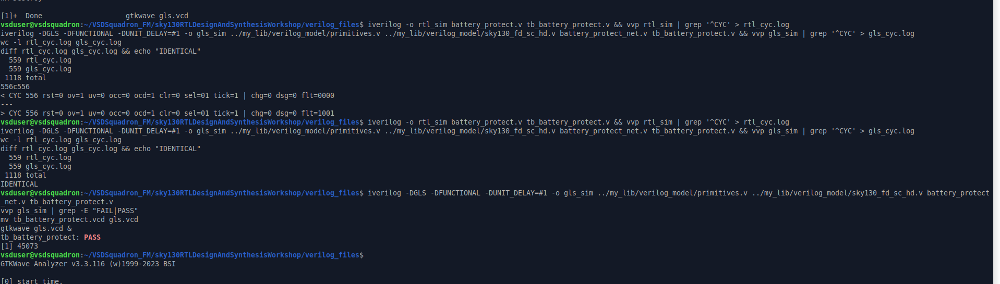

*Figure 4a. Terminal output of the comparison. The first run (upper part) shows one difference at CYC 556: the RTL log has `flt=0000` and the gate-level log has `flt=1001`, because that early version sampled 1 ns after an async reset, before the gate-level outputs had settled. After the logger was changed to sample 8 ns after the clock edge, the second run prints `IDENTICAL`, and the gate-level run prints `PASS`.*

### Waveforms

```
gtkwave tb_battery_protect.vcd
```

Signals worth adding: `clk, rst_n, ov, uv, occ, ocd, tick, clear, dbn_sel, chg_en, dsg_en, fault`.
Everything inside `dut` (counters, trips) is internal and can be ignored for comparison.

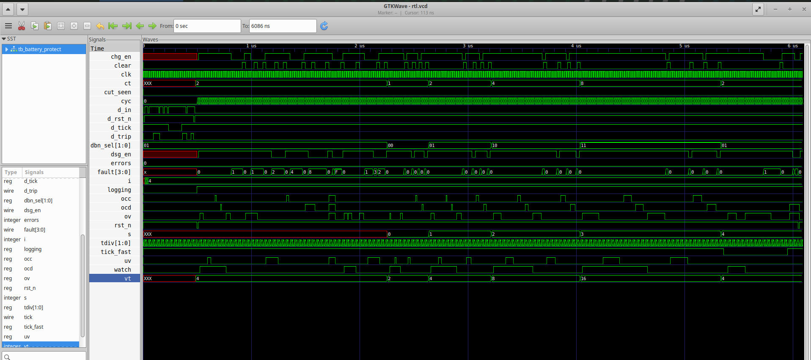

*Figure 3. GTKWave on the RTL run. The `d_in`, `d_rst_n`, `d_tick` and `d_trip` traces at the far left are Part A (standalone debounce).
Part B starts when `rst_n` falls and `logging` goes high. `dbn_sel` steps through 00, 01, 10, 11 (`vt` 2/4/8/16, `ct` 1/2/4/8) during test B13,
and `tick_fast` drops near the end for test B14. `errors` stays at 0.*

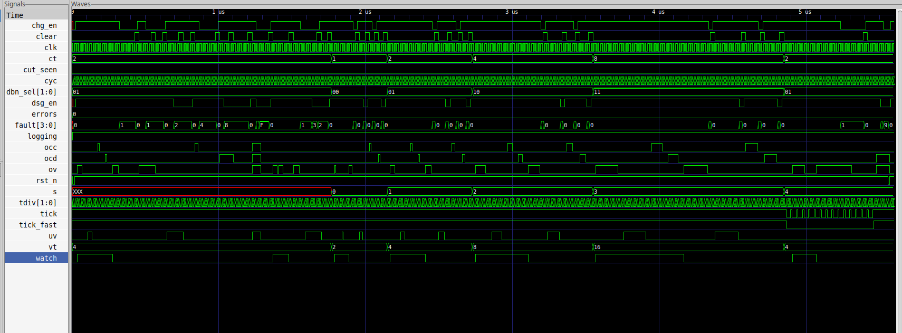

*Figure 4. GTKWave on the gate-level run. Part A is absent (it needs the `debounce` module), and the same Part B sequence plays out:
the same `dbn_sel` steps, the same fault pattern, `errors` = 0. Everything is shifted about 0.49 us earlier than in Figure 3, which is the length of Part A.*

### Reading the waveforms, case by case

The times below come from the RTL run, with a marker printed at the start of each test. Positions read off the screenshots are approximate.

**How to read Figure 3**

- The time axis runs 0 to 6.09 us, and each test is a slice of it.
- Red (X) at the start on `chg_en`, `dsg_en`, `fault`, `ct`, `vt` and `s` is expected. The design has no initial values, so these are undefined until the first reset at about 0.5 us.
- `ov`, `uv`, `occ`, `ocd`, `clear`, `rst_n`, `dbn_sel` and `tick_fast` are driven by the testbench.
- `chg_en`, `dsg_en` and `fault[3:0]` are the checked outputs. `errors` must stay 0.
- `vt` and `ct` show the current debounce limits, and `s` is the `dbn_sel` sweep counter.
- `watch` is high while the testbench checks that nothing gets cut. `cut_seen` is the alarm that would rise if something did.
- `d_in`, `d_rst_n`, `d_tick` and `d_trip` belong to Part A, the standalone debounce test.

| Case | Window (us) | What you see | What it proves |
|---|---|---|---|
| **Part A** (A1 to A6) | 0 to 0.49 | Only the `d_*` traces move. `d_trip` pulses a few times. `d_tick` goes low from about 0.24 to 0.36. | The debounce alone trips at exactly its limit, holds, drops with the input, restarts if interrupted, does not count without `tick`, and clears on an async reset. |
| **B1** reset | 0.486 to 0.508 | `rst_n` falls at about 0.5. The red X on `chg_en`, `dsg_en` and `fault` becomes 0. `logging` goes high. | Reset forces both outputs off and clears all faults. |
| **B2** wake-up | 0.508 to 0.526 | `rst_n` rises, and two clocks later `chg_en` and `dsg_en` go high. | Outputs come on after reset, not instantly. |
| **B3** short glitches | 0.526 to 0.766 | Four narrow pulses on `ov`, `uv`, `occ`, `ocd`. `watch` is high. `fault` stays 0 and both enables stay high. | A pulse one clock shorter than the limit is ignored, and `cut_seen` never rises. |
| **B4** OV trips | 0.766 to 0.946 | `ov` high for 4 clocks, `fault` shows `1`, `chg_en` drops, then `clear` brings it back. | OV trips at exactly the limit, cuts only charge, and stays latched after the flag drops (see Figure 2). |
| **B5** sustained OV | 0.946 to 1.136 | A longer `ov`, a `clear` pulse while `ov` is still high, then `ov` drops and a second `clear`. `fault` stays `1` until the second `clear`. | `clear` is ignored while the raw flag is present. |
| **B6** UV | 1.136 to 1.326 | `fault` shows `2`. `dsg_en` drops and `chg_en` stays high. | UV cuts only discharge, with the same latching. |
| **B7** OCC | 1.326 to 1.496 | `fault` shows `4`. `chg_en` drops. | Charge over-current cuts only charge. |
| **B8** OCD | 1.496 to 1.716 | `fault` shows `8`. `dsg_en` drops. | Discharge over-current cuts only discharge. |
| **B9** all four | 1.716 to 1.856 | `fault` shows `F` and both enables are low together. | The four faults are independent and combine correctly. |
| **B10** split pulses | 1.856 to 1.966 | `ov` pulses twice with a one-clock gap. `watch` is high. `fault` stays 0. | The count restarts when the flag drops, so two short pulses do not add up. |
| **B11** clear with no fault | 1.966 to 1.996 | One `clear` pulse and nothing changes. | A stray `clear` is harmless. |
| **B12** selective release | 1.996 to 2.256 | `fault` goes `1`, then `3`, then `2`, then `0`. | One `clear` released OV (its flag was gone) but held UV (its flag was still present). A second `clear` released UV after its flag dropped. |
| **B13** `dbn_sel` sweep | 2.256 to 5.356 | `dbn_sel` steps 00, 01, 10, 11 and back to 01. `vt` and `ct` change with it. The pulses get longer in each sweep. | Every setting trips at exactly its own limit (details below). |
| **B14** slow tick | 5.356 to 5.966 | `tick_fast` goes low from about 5.36 to 5.95. A short `ov` does nothing, then a long `ov` makes `fault` show `1`. | The debounce counts ticks, not clocks. |
| **B15** reset mid-fault | 5.966 to 6.086 | `fault` shows `9` (OV and OCD), then `rst_n` dips low at the far right and everything goes to 0. | An async reset clears latched faults and turns the outputs off immediately. |

**B13 in detail.** It has four sweeps. The limits are the values you see on `vt` and `ct`:

| `dbn_sel` | `vt` (ov, uv) | `ct` (occ, ocd) | Starts at (us) |
|---|---|---|---|
| 00 | 2 | 1 | about 2.26 |
| 01 | 4 | 2 | about 2.64 |
| 10 | 8 | 4 | about 3.22 |
| 11 | 16 | 8 | about 4.04 |

Each sweep does the same two things. First it sends a pulse one clock short of the limit on each flag, and nothing trips (the `watch` high region). Then it sends a pulse of exactly the limit on each flag in turn, so `fault` shows 1, 2, 4, 8 one after another, each followed by a `clear`.

The sweeps take longer as the limits grow, which is why the pulses on the right of Figure 3 are so much wider. At setting 00, `ct` is 1, so the occ/ocd glitch test is skipped, and a one-clock pulse there is the limit and trips straight away.

**What a failure would look like**

- `errors` going above 0, with the console printing the failing test and time.
- `cut_seen` rising, which means a glitch caused a cut-off.
- `fault` showing the wrong value, for example `3` where the testbench expects `1`.
- `chg_en` or `dsg_en` dropping at the wrong time.

None of this happens in the run shown.

**Gate-level run (Figure 4).** The same sequence appears with two differences. The `d_*` Part A traces are absent, because the netlist has no standalone `debounce` module. Everything is also about 0.49 us earlier, so the `dbn_sel` steps appear at about 1.77, 2.15, 2.73, 3.55 and 4.85 us.

### Problems found and fixed during verification

| Problem | Cause | Fix |
|---|---|---|
| iverilog error: `debounce` not found in GLS | The flattened netlist has no `debounce` module | Compile with `-DGLS` to skip Part A |
| FAIL in B15, later B4, only in GLS | 1 ns cell delays raced the checks | `SETTLE` macro (4 ns in GLS) and `#2` after async reset |
| One-line CYC diff at CYC 556 | Logger sampled 1 ns after an async reset, before GLS outputs settled | Sample 8 ns after the rising edge |
| Different tick phase RTL vs GLS | `tdiv` ran free | Reset `tdiv` with `rst_n` |
| Different reset length RTL vs GLS | Reset released at different clock counts | Release one clock after asserting, in both runs |

---

## 5. Synthesis

Two synthesis runs were done, both against the `sky130_fd_sc_hd__tt_025C_1v80` library:

| Run | Chip area |
|---|---|
| Standalone Yosys check (flatten + abc) | 1368.8128 um^2 |
| OpenLane synthesis (run `final2`, `SYNTH_STRATEGY=AREA 0`) | **1347.5424 um^2** |

The two use different scripts, so they differ by about 21 um^2. The OpenLane number is the one this project reports, because that netlist is what went through the rest of the flow.

**Cells after OpenLane synthesis: 120** (from `reports/synthesis/*stat*.rpt`).

| Cell | Count | Cell | Count |
|---|---|---|---|
| `inv_2` | 27 | `buf_1` | 4 |
| `dfrtp_2` (flip-flop) | 26 | `o221a_2` | 4 |
| `o21a_2` | 13 | `o221ai_2` | 4 |
| `or2_2` | 11 | `a211oi_2`, `and2_2`, `nor4_2`, `or3_2`, `or3b_2` | 2 each |
| `nand2_2`, `o211a_2` | 7 each | `and3_2`, `and3b_2` | 1 each |
| `nor2_2` | 5 | | |

That is 26 flip-flops and 94 combinational cells. The 26 flip-flops match the design: 20 counter bits (4 x 5), 4 fault bits and the two enables.

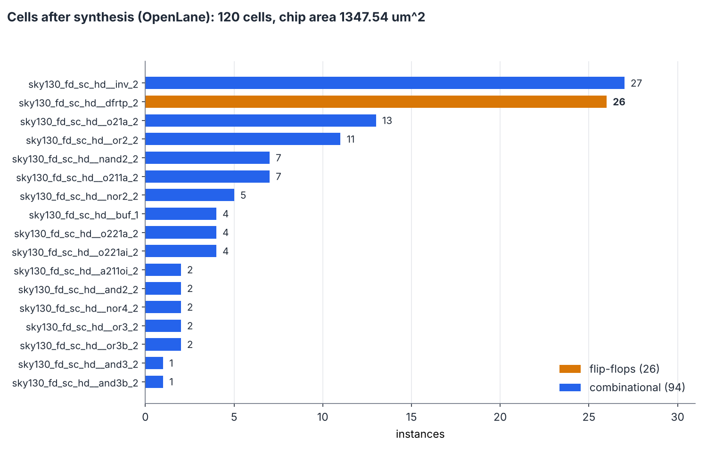

*Figure 5a. Cell mix after OpenLane synthesis. The inverters and the flip-flops are the two largest groups.*

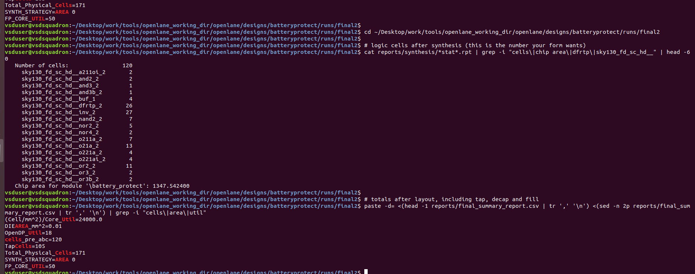

*Figure 5b. Terminal output for run `final2`: the synthesis cell list with the chip area of 1347.542400, and the summary-report fields for the placed design.*

---

## 6. Static timing analysis

### Constraints (`battery_protect.sdc`)

- `create_clock -name clk -period 10.0`
- Input delay and output delay of 0.2 x period = 2 ns on every non-clock pin.

### Corners

All 16 `sky130_fd_sc_hd` library corners, with OpenSTA. Setup is expected to be worst at the
`ss_*` corners and hold at the `ff_*` corners. Pre-layout STA uses ideal wires. Post-route STA
uses the routed netlist, extracted parasitics (SPEF, one nominal corner) and a propagated clock.

### 6.1 Pre-layout (post-synthesis), clock 10 ns

| Corner | Setup (ns) | Hold (ns) | TNS | Status |
|---|---|---|---|---|
| ff_100C_1v65 | 6.70 | 0.35 | 0.00 | MET |
| ff_100C_1v95 | 6.99 | 0.28 | 0.00 | MET |
| ff_n40C_1v56 | 6.30 | 0.40 | 0.00 | MET |
| ff_n40C_1v65 | 6.53 | 0.35 | 0.00 | MET |
| ff_n40C_1v76 | 6.74 | 0.31 | 0.00 | MET |
| ff_n40C_1v95 | 6.98 | 0.26 | 0.00 | MET |
| ss_100C_1v40 | 2.02 | 1.09 | 0.00 | MET |
| ss_100C_1v60 | 4.08 | 0.86 | 0.00 | MET |
| ss_n40C_1v28 | -8.38 | -0.27 | -80.81 | VIOLATED |
| ss_n40C_1v35 | -2.91 | 0.43 | -16.19 | VIOLATED |
| ss_n40C_1v40 | -0.68 | 0.74 | -1.17 | VIOLATED |
| ss_n40C_1v44 | 0.61 | 0.91 | 0.00 | MET |
| ss_n40C_1v60 | 3.53 | 0.86 | 0.00 | MET |
| ss_n40C_1v76 | 4.88 | 0.65 | 0.00 | MET |
| tt_025C_1v80 | 6.24 | 0.42 | 0.00 | MET |
| tt_100C_1v80 | 6.28 | 0.43 | 0.00 | MET |

13 of 16 corners meet timing.

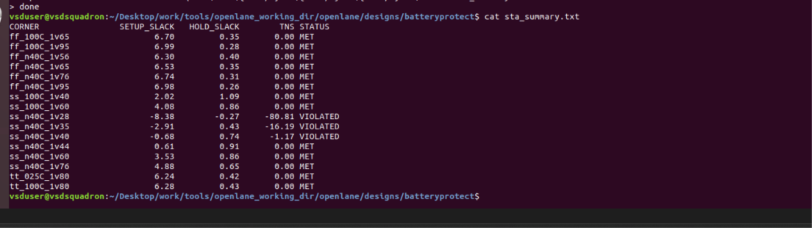

*Figure 5. Terminal output of the pre-layout summary table.*

### 6.2 Post-route (run `final2`), clock 10 ns

| Corner | Setup (ns) | Hold (ns) | TNS | Status |
|---|---|---|---|---|
| ff_100C_1v65 | 6.95 | 0.40 | 0.00 | MET |
| ff_100C_1v95 | 7.19 | 0.32 | 0.00 | MET |
| ff_n40C_1v56 | 6.61 | 0.46 | 0.00 | MET |
| ff_n40C_1v65 | 6.81 | 0.41 | 0.00 | MET |
| ff_n40C_1v76 | 6.98 | 0.37 | 0.00 | MET |
| ff_n40C_1v95 | 7.17 | 0.31 | 0.00 | MET |
| ss_100C_1v40 | 3.31 | 0.38 | 0.00 | MET |
| ss_100C_1v60 | 4.90 | 0.89 | 0.00 | MET |
| ss_n40C_1v28 | -6.28 | -2.42 | -51.10 | VIOLATED |
| ss_n40C_1v35 | -1.28 | -1.22 | -3.71 | VIOLATED |
| ss_n40C_1v40 | 0.92 | -0.56 | 0.00 | VIOLATED (hold) |
| ss_n40C_1v44 | 2.14 | -0.19 | 0.00 | VIOLATED (hold) |
| ss_n40C_1v60 | 4.44 | 0.62 | 0.00 | MET |
| ss_n40C_1v76 | 5.55 | 0.74 | 0.00 | MET |
| tt_025C_1v80 | 6.58 | 0.48 | 0.00 | MET |
| tt_100C_1v80 | 6.62 | 0.49 | 0.00 | MET |

12 of 16 corners meet timing.

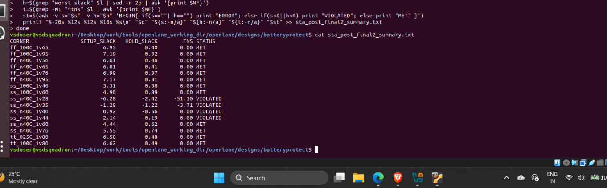

*Figure 6. Terminal output of the post-route summary table for run `final2`.*

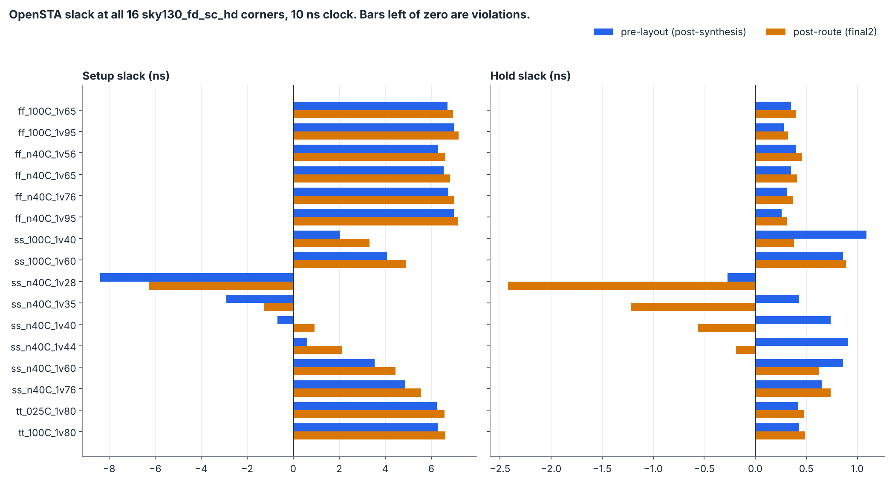

*Figure 7. The same data as Figures 5 and 6, plotted per corner. Setup improved after layout at every failing corner, and hold got worse at
the four cold slow corners.*

The next four figures break the same data out individually. Bars hatched in red are violations, and every bar carries its value, so nothing depends on color alone.

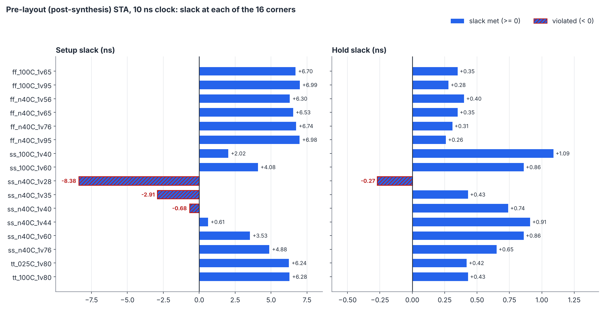

*Figure 7a. Pre-layout STA on its own: setup and hold slack at each of the 16 corners. Three corners fail setup (`ss_n40C_1v28`, `1v35`, `1v40`), and `ss_n40C_1v28` also fails hold by 0.27 ns.*

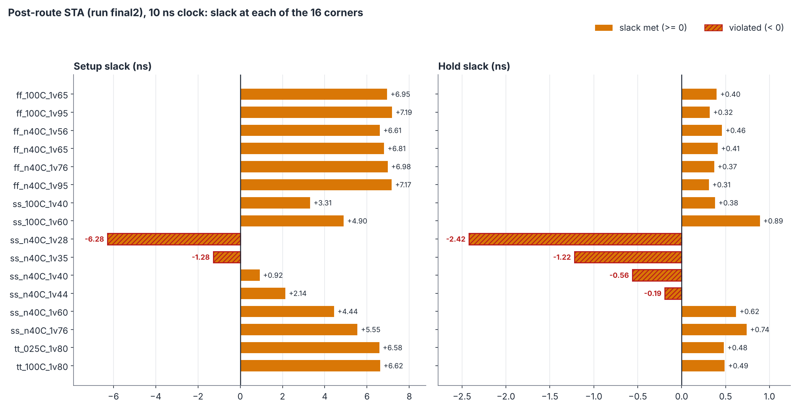

*Figure 7b. Post-route STA on its own (run `final2`). Setup fails at `ss_n40C_1v28` and `1v35`. Hold fails at `1v28`, `1v35`, `1v40` and `1v44`, and the worst hold slack is -2.42 ns.*

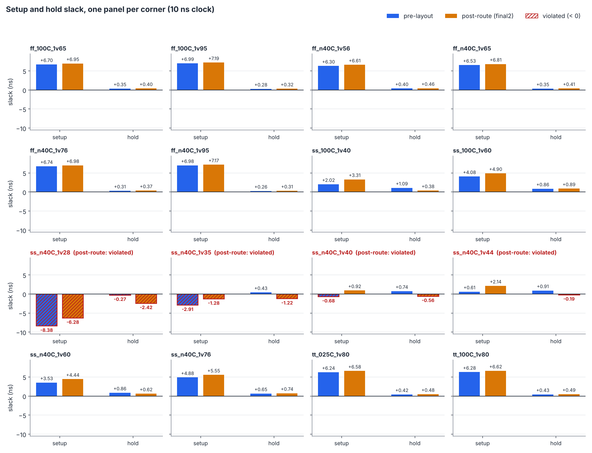

*Figure 7c. One panel per corner, with pre-layout (blue) and post-route (orange) side by side for setup and hold. Panel titles in red mark corners that violate after routing.*

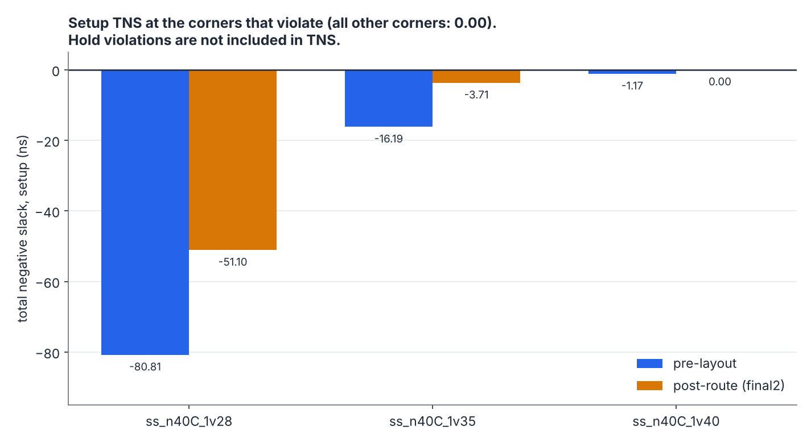

*Figure 7d. Total negative slack (setup only) at the corners that violate. Post-route TNS is lower than pre-layout at `ss_n40C_1v28` (-51.10 against -80.81) and `1v35` (-3.71 against -16.19), and zero at `1v40`. Hold violations are not counted in TNS.*

### 6.3 Reading the results

- The standard signoff corners (`tt_025C_1v80`, `ss_100C_1v60`, `ff_n40C_1v95`) all pass in both tables.
- Every corner at or above 1.60 V passes. The four failing corners are the cold slow corners at 1.28 to 1.44 V,
  which are below sky130's rated 1.6 V minimum supply.
- Setup improved after layout (for example `ss_n40C_1v28` from -8.38 to -6.28 ns).
- Hold got worse at the cold slow corners after clock tree synthesis. OpenLane repairs hold only at its own
  typical corner, so these corners were never repaired. The exact failing path has not been examined yet, so the
  clock-skew explanation is an inference from the pattern. Look at it with
  `sed -n '/--- HOLD/,/--- SUMMARY/p' reports_post_final2/sta_ss_n40C_1v44.log`.
- Fixing the four corners would need a longer clock period (setup) and hold buffers or less skew (hold).
  Whether that is required depends on the project rules. Otherwise report them as out-of-range exceptions.
- The SPEF is from one nominal parasitic corner, not one per timing corner.

### 6.4 How to run

```
# pre-layout (netlist = OpenLane synthesis output)
LIB=./sky130_fd_sc_hd__<corner>.lib CORNER=<corner> sta -no_splash -exit sta_corner.tcl

# post-route
export NETLIST=runs/final2/results/final/verilog/gl/battery_protect.v   # or synthesis/battery_protect.synthesis_cts.v
export SPEF=runs/final2/results/final/spef/battery_protect.spef          # or routing/battery_protect.spef
LIB=./sky130_fd_sc_hd__<corner>.lib CORNER=<corner> NETLIST=$NETLIST SPEF=$SPEF sta -no_splash -exit sta_post.tcl
```

`sta_post.tcl` reads the library, netlist, `src/battery_protect.sdc`, runs `set_propagated_clock [all_clocks]`,
reads the SPEF, then reports setup and hold paths, worst slack, TNS and clock skew.
The per-corner logs are in `reports/`, `reports_post*/`.

---

## 7. Physical flow (OpenLane v0.21, Docker)

`config.tcl`:

```
set ::env(DESIGN_NAME) "battery_protect"
set ::env(VERILOG_FILES) "$::env(DESIGN_DIR)/src/battery_protect.v"
set ::env(CLOCK_PORT) "clk"
set ::env(CLOCK_PERIOD) "10.0"
set ::env(BASE_SDC_FILE) "$::env(DESIGN_DIR)/src/battery_protect.sdc"
set ::env(FP_SIZING) "absolute"
set ::env(DIE_AREA) "0 0 100 100"
set ::env(CORE_AREA) "5 5 95 95"
set ::env(PL_TARGET_DENSITY) 0.5
set ::env(FP_PDN_VPITCH) 40
set ::env(FP_PDN_HPITCH) 40
set ::env(FP_PDN_VOFFSET) 10
set ::env(FP_PDN_HOFFSET) 10
```

Notes: the `dir::` prefix is not supported in v0.21, so the config is `config.tcl` using `$::env(DESIGN_DIR)`.
The folder name (`batteryprotect`) is the design name for `prep`, while `DESIGN_NAME` is the module (`battery_protect`).

### Recommended: whole flow in one command

```
cd ~/Desktop/work/tools/openlane_working_dir/openlane
docker
./flow.tcl -design batteryprotect -tag final2 -overwrite
```

### Interactive (step by step)

```
./flow.tcl -interactive
package require openlane 0.9
prep -design batteryprotect -tag final -overwrite
run_synthesis
run_floorplan
run_placement
run_cts
run_routing
run_magic
run_magic_spice_export
run_lvs
run_magic_drc
run_antenna_check
```

### What went wrong the first time, and why it matters

- **CTS was skipped** in the first interactive run (`logs/cts` empty). Routing then ran on a placement with no clock tree,
  which makes its SPEF unusable for signoff. The flow was rerun from scratch.
- **LVS reported 7 errors** in the interactive run. Cell and pin counts matched (147 vs 147, 0 unmatched pins),
  and every signal net matched. The only mismatches were the tap, decap and fill cells: in the layout their power pins
  connect to `VPWR`/`VGND`, while in the compared netlist they had no pin connections, so netgen invented `_noconnect_` nets.
  No powered netlist had been written. The full automated flow handles this and reports LVS clean.

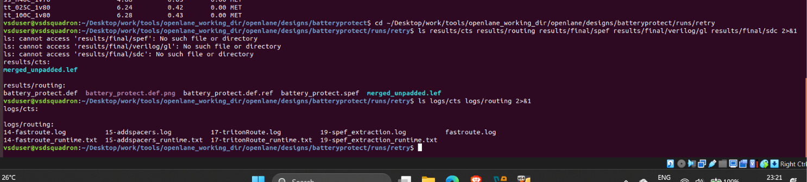

*Figure 8. First run: `results/cts` holds only a LEF file and `logs/cts` is empty, so CTS never ran.*

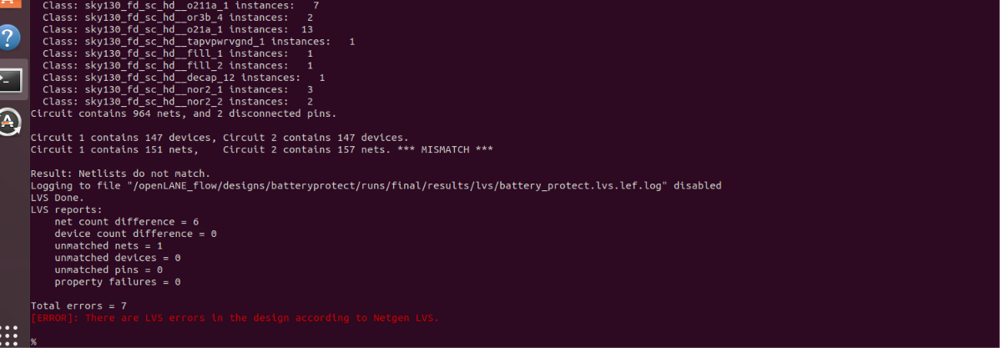

*Figure 9. First run: 147 devices on both sides, but 151 nets against 157, giving 7 errors. Only power nets and the `_noconnect_` placeholders differ.*

---

## 8. Final results (run `final2`)

| Check | Result |
|---|---|
| Flow | `Flow Completed Without Fatal Errors`, 4 min 38 s |
| Magic DRC | 0 violations |
| LVS | 0 errors, no net, device, pin or property mismatches |
| Antenna | 0 pins, 0 nets violated |
| Circuit-validity check (CVC) | 0 errors |
| Post-route STA | 12 of 16 corners met; all corners at or above 1.60 V met (section 6.2) |
| Logic cells after synthesis | 120 (26 flip-flops, 94 combinational) |
| Synthesis chip area | 1347.5424 um^2 |
| Die | 0.01 mm^2, which is 100 x 100 um (`DIEAREA_mm^2` = 0.01) |
| Placement utilization | `OpenDP_Util` = 18 percent of the core area |
| Physical cells reported by OpenLane | `Total_Physical_Cells` = 171, `TapCells` = 105 |
| Placed cell area (estimate) | about 1,460 um^2 (18 percent of the 90 x 90 um core, which is 8,100 um^2). This is derived from a utilization that is rounded to a whole percent, so read it as roughly 1,420 to 1,500 um^2. It is not a measured value. |
| Area against the 5,500 um^2 limit | The synthesis area is 1347.5 um^2, about 24.5 percent of the limit. The estimated placed area is also well under it, at roughly 26 to 27 percent. |

The summary counters `Total_Physical_Cells` (171) and `TapCells` (105) are quoted exactly as OpenLane prints them. They do not add up as 120 logic cells plus 105 tap cells, so the summary counts the cells differently from the synthesis report. Quote them with their labels, and take the exact post-layout cell and area breakdown from the OpenROAD reports (command in section 9).

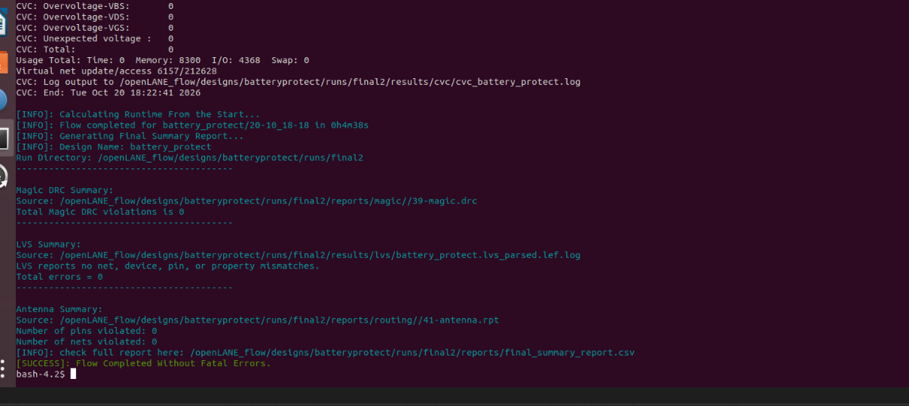

*Figure 10. End of the `final2` run: 0 Magic DRC violations, LVS with 0 errors, 0 antenna violations, `Flow Completed Without Fatal Errors`.*

Get the area numbers:

```
cd runs/final2
paste -d= <(head -1 reports/final_summary_report.csv | tr ',' '\n') \
          <(sed -n 2p reports/final_summary_report.csv | tr ',' '\n') | grep -i "area\|cells\|util"
```

Key output files (inside `runs/final2/results/`):

| File | Location |
|---|---|
| Layout (GDS) | `final/gds/battery_protect.gds` (also `magic/battery_protect.gds`) |
| Parasitics | `final/spef/` |
| Netlist | `final/verilog/gl/battery_protect.v` |
| Layout preview image | `magic/battery_protect.gds.png` |

View the layout:

```
magic -T ~/Desktop/work/tools/openlane_working_dir/pdks/sky130A/libs.tech/magic/sky130A.tech \
  runs/final2/results/final/mag/battery_protect.mag
```

(`v` fits the window. KLayout works too, with the sky130A `.lyp` layer file.)

### Layout views

The four views below show the 100 x 100 um die. The scale bar in the lower-left corner is 4 um. The descriptions say only what is visible in each image.

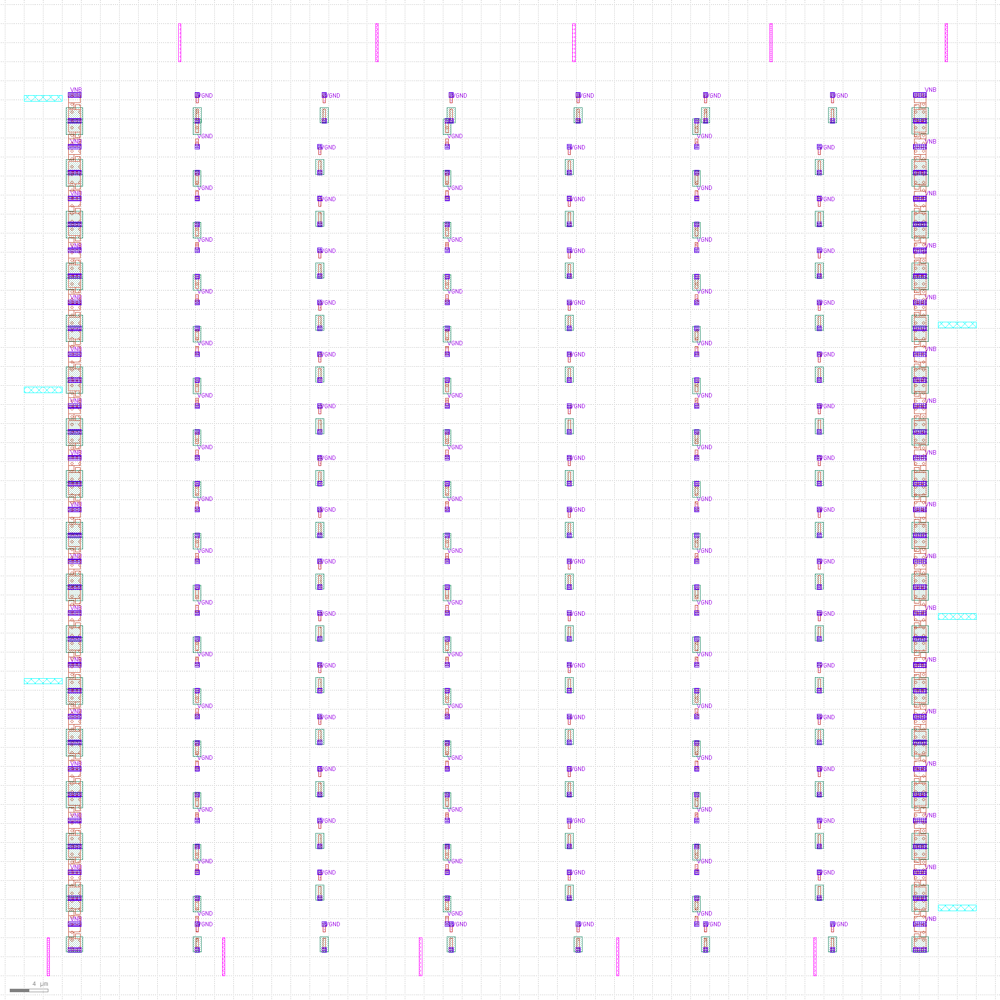

*Figure 11. Only the tap cells (the regularly spaced small cells in vertical columns) and the I/O pin shapes on the die edges. No logic and no wiring are shown.*

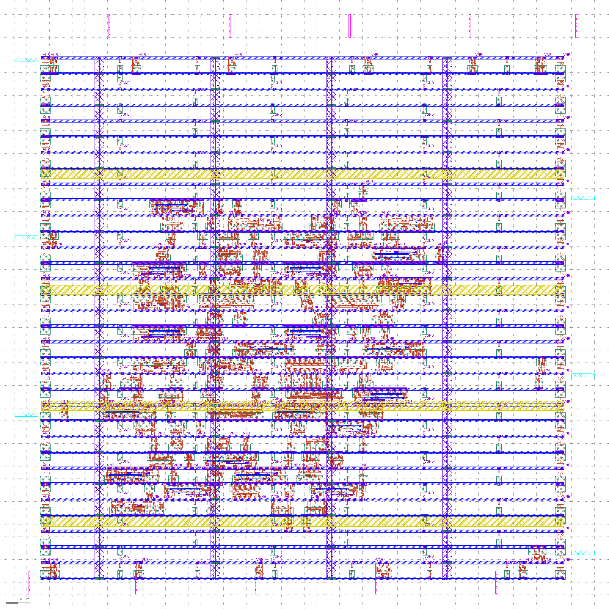

*Figure 12. The placed logic cells in the middle of the core, with the power grid: horizontal rails along every cell row and vertical straps. Signal wiring is hidden.*

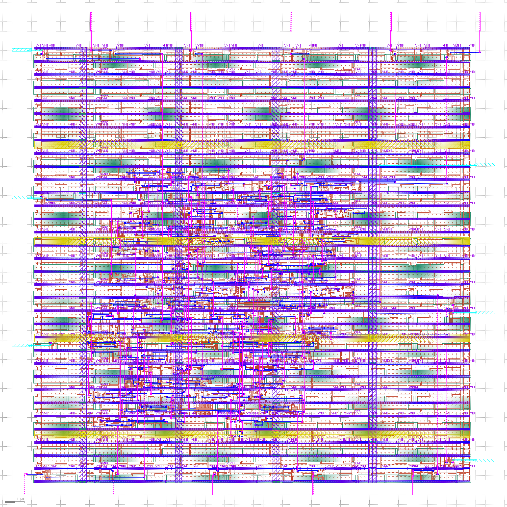

*Figure 13. The routed layout: signal wires across the logic, with the decap and fill cells filling the remaining space in every row. The logic occupies the central area and the rest of the core is filler.*

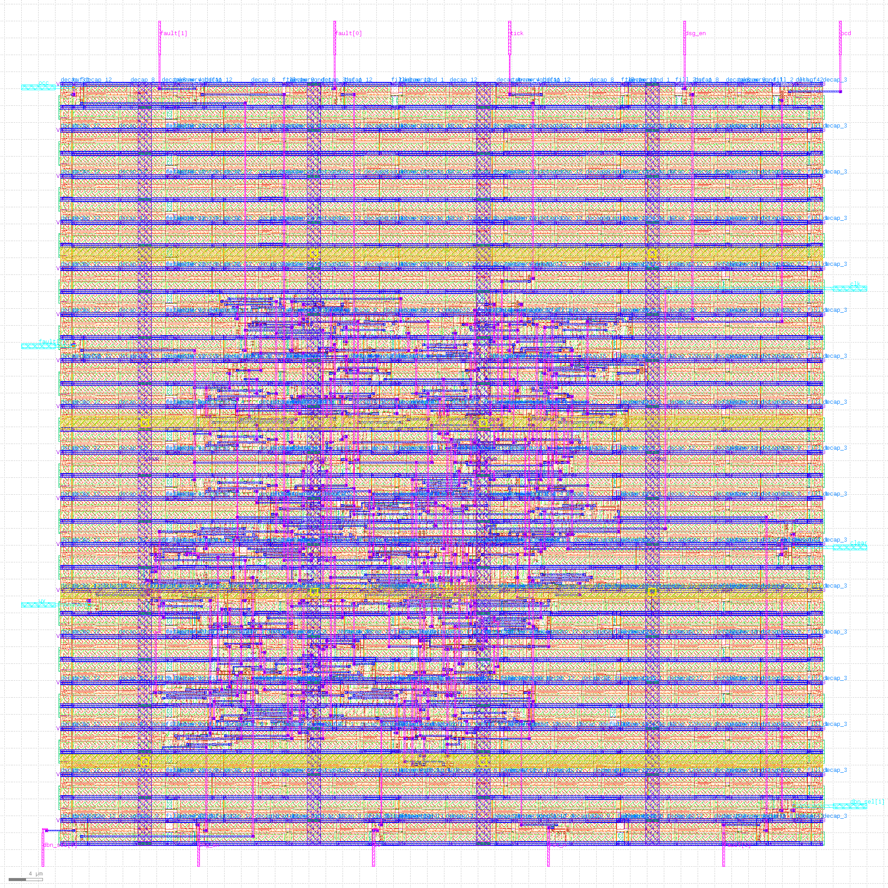

*Figure 14. The same routed layout with cell-name and pin labels turned on. The top edge shows pin names such as `fault[1]`, `fault[0]`, `tick`, `dsg_en` and `ocd`, and the rows are labeled with filler cell names (`decap_3`, `decap_12`, `fill_1` and so on).*

---

## 9. Still to do

- Replace the estimated placed area in section 8 with the measured one. OpenROAD prints it as a design area line, so
  `grep -rih "design area" runs/final2/logs runs/final2/reports | tail -5` should show it.
- Run GLS on the OpenLane netlist (`final/verilog/gl/battery_protect.v` or the post-synthesis netlist) with
  the same testbench and diff the `CYC` logs against RTL. The GLS above used the standalone Yosys netlist.
- Decide how to treat the four failing low-voltage corners (exception or fix), after looking at the failing hold path.
- Update the project form or document so it describes `battery_protect` (16 pins, async reset, no synchronizers, the limits above,
  the `clear` behaviour) and uses the real numbers from this run. Counts quoted from an earlier checklist
  (521 checks, 539 cells) were not produced by this project and should not be used.

## 10. Command reference: everything used to produce the outputs

Commands are in the order they were run. Paths are the ones on the VM used for this project, so adjust them for another machine.

### 10.1 RTL simulation and waveform

Run from `~/VSDSquadron_FM/sky130RTLDesignAndSynthesisWorkshop/verilog_files`.

```bash
iverilog -o rtl_sim battery_protect.v tb_battery_protect.v && vvp rtl_sim | grep '^CYC' > rtl_cyc.log
vvp rtl_sim | grep -E "FAIL|PASS"      # must print: tb_battery_protect: PASS
gtkwave tb_battery_protect.vcd         # view the waveform (Figure 3)
```

### 10.2 Standalone Yosys synthesis (area estimate and the gate-level netlist)

This reconstructs the standard sequence. The exact script typed during the project was not saved, so check it against your own history before quoting it. The result it produced was a chip area of 1368.8128 um^2 at `tt_025C_1v80`.

```bash
LIB=~/Desktop/work/tools/openlane_working_dir/pdks/sky130A/libs.ref/sky130_fd_sc_hd/lib/sky130_fd_sc_hd__tt_025C_1v80.lib
yosys
```

then, at the `yosys>` prompt:

```
read_verilog battery_protect.v
synth -top battery_protect -flatten
dfflibmap -liberty <LIB>
abc -liberty <LIB>
clean
stat -liberty <LIB>
write_verilog -noattr battery_protect_net.v
```

Replace `<LIB>` with the full liberty path. To draw the netlist, read the liberty with `read_liberty -lib <LIB>` first and name the module explicitly, for example `show battery_protect`. Without the module name Yosys complains about multiple modules.

### 10.3 Gate-level simulation and RTL vs GLS comparison

Run from the same `verilog_files` folder. The sky130 cell models are in `../my_lib/verilog_model/`.

```bash
iverilog -DGLS -DFUNCTIONAL -DUNIT_DELAY=#1 -o gls_sim \
  ../my_lib/verilog_model/primitives.v ../my_lib/verilog_model/sky130_fd_sc_hd.v \
  battery_protect_net.v tb_battery_protect.v && vvp gls_sim | grep '^CYC' > gls_cyc.log
vvp gls_sim | grep -E "FAIL|PASS"
mv tb_battery_protect.vcd gls.vcd
gtkwave gls.vcd &                      # view the gate-level waveform (Figure 4)
wc -l rtl_cyc.log gls_cyc.log          # 559 lines each
diff rtl_cyc.log gls_cyc.log && echo "IDENTICAL"
```

### 10.4 OpenLane project setup

```bash
cd ~/Desktop/work/tools/openlane_working_dir/openlane/designs
mkdir -p batteryprotect/src
cp <your files>/battery_protect.v batteryprotect/src/
# create batteryprotect/config.tcl as in section 7
# create batteryprotect/src/battery_protect.sdc as in Appendix C
```

### 10.5 OpenLane flow

The first run was interactive (tag `retry`). The CTS step was missed there, which is why the whole flow was redone.

```bash
cd ~/Desktop/work/tools/openlane_working_dir/openlane
docker
./flow.tcl -interactive
```

then, at the `%` prompt:

```
package require openlane 0.9
prep -design batteryprotect -tag retry -overwrite
run_synthesis
run_floorplan
run_placement
run_cts
run_routing
run_magic
run_magic_spice_export
run_lvs
run_magic_drc
run_antenna_check
```

The final run (tag `final2`) used the automated flow, which also writes the powered netlist before LVS:

```bash
cd ~/Desktop/work/tools/openlane_working_dir/openlane
docker
./flow.tcl -design batteryprotect -tag final2 -overwrite
```

### 10.6 Checking what a run produced

```bash
cd ~/Desktop/work/tools/openlane_working_dir/openlane/designs/batteryprotect/runs/final2
ls logs/cts                                  # must not be empty
ls results/final/gds results/final/spef results/final/verilog/gl results/final/sdc
cat reports/synthesis/*stat*.rpt | tail -60  # logic cell counts and synthesis area
paste -d= <(head -1 reports/final_summary_report.csv | tr ',' '\n') \
          <(sed -n 2p reports/final_summary_report.csv | tr ',' '\n') | grep -i "cells\|area\|util"
```

### 10.7 Pre-layout STA, all 16 corners

The 16 `sky130_fd_sc_hd__*.lib` corner files were copied into the design folder first. The synthesis netlist and SDC come from the `retry` run (synthesis is deterministic, so the `final` run gives the same result).

```bash
cd ~/Desktop/work/tools/openlane_working_dir/openlane/designs/batteryprotect
cp runs/retry/results/synthesis/battery_protect.synthesis.v .
cp src/battery_protect.sdc .
which sta        # /usr/bin/sta on this VM

cat > sta_corner.tcl << 'EOF'
read_liberty $::env(LIB)
read_verilog battery_protect.synthesis.v
link_design battery_protect
read_sdc battery_protect.sdc

puts "=== corner: $::env(CORNER) ==="
puts "--- setup (max) ---"
report_checks -path_delay max -digits 3
puts "--- hold (min) ---"
report_checks -path_delay min -digits 3
puts "--- summary ---"
report_worst_slack -max
report_worst_slack -min
report_tns
EOF

mkdir -p reports
for f in ./sky130_fd_sc_hd__*.lib; do
  c=$(basename $f .lib | sed 's/sky130_fd_sc_hd__//')
  echo "running $c"
  LIB=$f CORNER=$c sta -no_splash -exit sta_corner.tcl > reports/sta_$c.log 2>&1
done
```

Summary table (this version of OpenSTA prints `worst slack` with no max or min word, so the first such line is setup and the second is hold):

```bash
printf "%-20s %12s %12s %10s %s\n" CORNER SETUP_SLACK HOLD_SLACK TNS STATUS > sta_summary.txt
for l in reports/sta_*.log; do
  c=$(basename $l .log | sed 's/^sta_//')
  s=$(grep "worst slack" $l | sed -n 1p | awk '{print $NF}')
  h=$(grep "worst slack" $l | sed -n 2p | awk '{print $NF}')
  t=$(grep -m1 "^tns" $l | awk '{print $NF}')
  st=$(awk -v s="$s" -v h="$h" 'BEGIN{ if(s==""||h=="") print "ERROR"; else if(s<0||h<0) print "VIOLATED"; else print "MET" }')
  printf "%-20s %12s %12s %10s %s\n" "$c" "${s:-n/a}" "${h:-n/a}" "${t:-n/a}" "$st" >> sta_summary.txt
done
cat sta_summary.txt
```

To read one corner's report: `less reports/sta_tt_025C_1v80.log`, or print only its hold section with `sed -n '/--- hold/,/--- summary/p' reports/sta_ss_n40C_1v28.log`.

### 10.8 Post-route STA, all 16 corners (run `final2`)

The netlist is the post-CTS netlist from the `synthesis` results folder. The parasitics come from the routing SPEF (one nominal corner). The clock is propagated so the real clock tree delays count.

```bash
cd ~/Desktop/work/tools/openlane_working_dir/openlane/designs/batteryprotect
export NETLIST=runs/final2/results/synthesis/battery_protect.synthesis_cts.v
export SPEF=runs/final2/results/routing/battery_protect.spef
ls $NETLIST $SPEF

cat > sta_post.tcl << 'EOF'
read_liberty $::env(LIB)
read_verilog $::env(NETLIST)
link_design battery_protect
read_sdc src/battery_protect.sdc
set_propagated_clock [all_clocks]
read_spef $::env(SPEF)
puts "=== POST-ROUTE corner: $::env(CORNER) ==="
puts "--- SETUP (max) ---"
report_checks -path_delay max -format full_clock_expanded -digits 3
puts "--- HOLD (min) ---"
report_checks -path_delay min -format full_clock_expanded -digits 3
puts "--- SUMMARY ---"
report_worst_slack -max
report_worst_slack -min
report_tns
report_clock_skew
EOF

mkdir -p reports_post_final2
for f in ./sky130_fd_sc_hd__*.lib; do
  c=$(basename $f .lib | sed 's/sky130_fd_sc_hd__//')
  echo "running $c"
  LIB=$f CORNER=$c NETLIST=$NETLIST SPEF=$SPEF sta -no_splash -exit sta_post.tcl > reports_post_final2/sta_$c.log 2>&1
done
```

Build the summary table with the same loop as in 10.7, reading `reports_post_final2/sta_*.log` and writing `sta_post_final2_summary.txt`. To see the failing hold path at one corner:

```bash
sed -n '/--- HOLD/,/--- SUMMARY/p' reports_post_final2/sta_ss_n40C_1v44.log
```

### 10.9 Viewing the layout

```bash
# Magic
magic -T ~/Desktop/work/tools/openlane_working_dir/pdks/sky130A/libs.tech/magic/sky130A.tech \
  runs/final2/results/final/mag/battery_protect.mag

# KLayout, if installed
klayout runs/final2/results/final/gds/battery_protect.gds \
  -l ~/Desktop/work/tools/openlane_working_dir/pdks/sky130A/libs.tech/klayout/sky130A.lyp
```

### 10.10 Notes on the first runs

- A first interactive run skipped CTS (`logs/cts` was empty), and its LVS reported 7 errors from unconnected power pins on filler cells. Both were fixed by rerunning the whole flow with the automated command in 10.5.
- OpenLane v0.21 does not accept the `dir::` prefix in `config.json`, so the project uses `config.tcl` with `$::env(DESIGN_DIR)`.

---

## Appendix A: RTL, `battery_protect.v`

The exact file that was simulated, synthesized and taken through OpenLane (debounce module plus top level).

```verilog
// battery_protect.v  (single file: debounce + top level)
// Lithium battery pack protection with debounced fault latching.
//
// Pins (16 signal pins):
//   inputs : clk, rst_n, ov, uv, occ, ocd, tick, clear, dbn_sel[1:0]
//   outputs: chg_en, dsg_en, fault[3:0]
//
// Faults (flags are raw comparator outputs, active high):
//   ov  - over-voltage            -> cuts charge
//   uv  - under-voltage           -> cuts discharge
//   occ - over-current on charge  -> cuts charge
//   ocd - over-current on discharge -> cuts discharge
//
// Each flag is debounced (counted in `tick` pulses), then latched into
// fault[3:0] = {ocd, occ, uv, ov}. A latched fault is released only by a
// `clear` that arrives while that fault's raw flag is low.
//
// dbn_sel picks the debounce length in ticks (over-current is twice as fast):
//   dbn_sel   ov / uv    occ / ocd
//     00         2          1
//     01         4          2
//     10         8          4
//     11        16          8
//
// Both MOSFET enables are 0 in reset and switch on after the first clock.
// All inputs are assumed to be synchronous to clk.

// ---------------------------------------------------------------
// Debouncer: trip goes high once `in` has been high for `limit`
// counted ticks in a row. Any low sample restarts the count.
// ---------------------------------------------------------------
module debounce (
    input  wire       clk,
    input  wire       rst_n,    // async active-low reset
    input  wire       tick,     // count enable (slow time base)
    input  wire       in,
    input  wire [4:0] limit,    // ticks required, 1..16
    output wire       trip
);
    reg [4:0] cnt;

    assign trip = (cnt >= limit);

    always @(posedge clk or negedge rst_n) begin
        if (!rst_n)
            cnt <= 5'd0;
        else if (!in)
            cnt <= 5'd0;
        else if (tick && !trip)
            cnt <= cnt + 5'd1;      // stops once the limit is reached
    end
endmodule

// ---------------------------------------------------------------
// Top level
// ---------------------------------------------------------------
module battery_protect (
    input  wire       clk,
    input  wire       rst_n,      // async active-low reset
    input  wire       ov,         // over-voltage flag
    input  wire       uv,         // under-voltage flag
    input  wire       occ,        // over-current on charge flag
    input  wire       ocd,        // over-current on discharge flag
    input  wire       tick,       // debounce time-base enable
    input  wire       clear,      // releases latched faults whose flag is gone
    input  wire [1:0] dbn_sel,    // debounce length select
    output reg        chg_en,     // charge MOSFET enable
    output reg        dsg_en,     // discharge MOSFET enable
    output reg  [3:0] fault       // latched faults {ocd, occ, uv, ov}
);
    // debounce limits chosen by dbn_sel
    wire [4:0] lim_v = 5'd2 << dbn_sel;     // ov, uv : 2, 4, 8, 16
    wire [4:0] lim_c = 5'd1 << dbn_sel;     // occ, ocd: 1, 2, 4, 8

    wire ov_trip, uv_trip, occ_trip, ocd_trip;

    debounce u_deb_ov  (.clk(clk), .rst_n(rst_n), .tick(tick), .in(ov),  .limit(lim_v), .trip(ov_trip));
    debounce u_deb_uv  (.clk(clk), .rst_n(rst_n), .tick(tick), .in(uv),  .limit(lim_v), .trip(uv_trip));
    debounce u_deb_occ (.clk(clk), .rst_n(rst_n), .tick(tick), .in(occ), .limit(lim_c), .trip(occ_trip));
    debounce u_deb_ocd (.clk(clk), .rst_n(rst_n), .tick(tick), .in(ocd), .limit(lim_c), .trip(ocd_trip));

    wire [3:0] trip = {ocd_trip, occ_trip, uv_trip, ov_trip};
    wire [3:0] raw  = {ocd,      occ,      uv,      ov};

    always @(posedge clk or negedge rst_n) begin
        if (!rst_n) begin
            chg_en <= 1'b0;
            dsg_en <= 1'b0;
            fault  <= 4'b0000;
        end else begin
            // set on trip; release only on clear while the raw flag is low
            fault <= trip | (fault & ~({4{clear}} & ~raw));

            // ov and occ cut charge; uv and ocd cut discharge
            chg_en <= ~(trip[0] | trip[2] | fault[0] | fault[2]);
            dsg_en <= ~(trip[1] | trip[3] | fault[1] | fault[3]);
        end
    end
endmodule

```

## Appendix B: Testbench, `tb_battery_protect.v`

The single self-checking testbench used for both the RTL and the gate-level runs (section 3 explains it line by line). Compile commands are in section 4.

```verilog
`timescale 1ns/1ps
// Single self-checking testbench for battery_protect (16-pin version).
//   Part A tests the debounce module on its own   (skipped with -DGLS,
//          because a flattened gate-level netlist has no debounce module)
//   Part B tests the battery_protect top level
//
// Compile:  RTL  -> iverilog -o rtl_sim battery_protect.v tb_battery_protect.v
//           GLS  -> iverilog -DGLS -DFUNCTIONAL -o gls_sim <sky130 models> battery_protect_net.v tb_battery_protect.v
`ifdef GLS
    `define SETTLE #4      // gate-level: let unit delays settle before sampling
`else
    `define SETTLE #1
`endif
module tb_battery_protect;
    reg  clk = 0;
    always #5 clk = ~clk;

`ifndef GLS
    // ---------------- Part A signals: standalone debounce ----------------
    localparam DN = 4;
    reg  d_rst_n = 1, d_in = 0, d_tick = 1;
    wire d_trip;
    debounce dut_deb (.clk(clk), .rst_n(d_rst_n), .tick(d_tick), .in(d_in),
                      .limit(5'd4), .trip(d_trip));
`endif

    // ---------------- Part B signals: top level ----------------
    reg        rst_n = 1;
    reg        ov = 0, uv = 0, occ = 0, ocd = 0, clear = 0;
    reg  [1:0] dbn_sel = 2'b01;          // ov/uv = 4 ticks, occ/ocd = 2 ticks
    reg        tick_fast = 1;            // 1: tick high every cycle, 0: every 4th cycle
    reg  [1:0] tdiv = 0;
    always @(posedge clk) if (!rst_n) tdiv <= 0; else tdiv <= tdiv + 1;   // restarts at each reset so RTL and GLS line up
    wire       tick = tick_fast | (tdiv == 2'd0);
    wire       chg_en, dsg_en;
    wire [3:0] fault;

    battery_protect dut (
        .clk(clk), .rst_n(rst_n),
        .ov(ov), .uv(uv), .occ(occ), .ocd(ocd),
        .tick(tick), .clear(clear), .dbn_sel(dbn_sel),
        .chg_en(chg_en), .dsg_en(dsg_en), .fault(fault));

    integer errors = 0;
    integer i, s, vt, ct;

    // watch for any unwanted cut-off (used by the glitch tests)
    reg watch = 0, cut_seen = 0;
    always @(posedge clk)
        if (watch && (chg_en === 1'b0 || dsg_en === 1'b0)) cut_seen <= 1;

    // text log of the top-level signals, so RTL and gate-level runs can be diffed
    initial $monitor("%0t rst=%b ov=%b uv=%b occ=%b ocd=%b clr=%b sel=%b | chg=%b dsg=%b flt=%b",
                     $time, rst_n, ov, uv, occ, ocd, clear, dbn_sel, chg_en, dsg_en, fault);

    // ---- per-clock log for exact RTL-vs-GLS comparison (starts at the first reset of Part B) ----
    integer cyc = 0;
    reg     logging = 0;
    always @(negedge rst_n) logging <= 1;
    always @(negedge clk)
        if (logging) begin
            #3;                              // sample 8 ns after the rising edge, well after every input and output has settled
            cyc = cyc + 1;
            $display("CYC %0d rst=%b ov=%b uv=%b occ=%b ocd=%b clr=%b sel=%b tick=%b | chg=%b dsg=%b flt=%b",
                     cyc, rst_n, ov, uv, occ, ocd, clear, dbn_sel, tick, chg_en, dsg_en, fault);
        end

    task check(input cond, input [8*52-1:0] msg);
        begin
            if (!cond) begin
                errors = errors + 1;
                $display("FAIL @%0t: %0s", $time, msg);
            end
        end
    endtask

    task wait_cycles(input integer n);
        begin repeat (n) @(posedge clk); `SETTLE; end
    endtask

    // hold flags {ocd,occ,uv,ov} high for n cycles, then low
    task pulse(input [3:0] mask, input integer n);
        begin
            ov = mask[0]; uv = mask[1]; occ = mask[2]; ocd = mask[3];
            wait_cycles(n);
            ov = 0; uv = 0; occ = 0; ocd = 0;
        end
    endtask

    task do_clear;
        begin clear = 1; wait_cycles(3); clear = 0; end
    endtask

    task all_ok(input [8*52-1:0] tag);
        begin
            check(chg_en === 1 && dsg_en === 1, tag);
            check(fault === 4'b0000, tag);
        end
    endtask

    initial begin
        $dumpfile("tb_battery_protect.vcd");
        $dumpvars(0, tb_battery_protect);

`ifndef GLS
        // =========================================================
        // Part A: debounce module (reset signal starts at 1 so
        // asserting it is a real falling edge)
        // =========================================================
        #1 d_rst_n = 0;
        #11;
        check(d_trip === 1'b0, "A1 trip low during reset");
        d_rst_n = 1;
        @(posedge clk); #1;
        check(d_trip === 1'b0, "A1 trip low after reset, in=0");

        // glitch shorter than the limit: no trip
        d_in = 1;
        for (i = 1; i < DN; i = i + 1) begin
            @(posedge clk); #1;
            check(d_trip === 1'b0, "A2 no trip before limit reached");
        end
        d_in = 0; @(posedge clk); #1;
        check(d_trip === 1'b0, "A2 no trip after limit-1 pulse");

        // exactly the limit: trips, holds, drops with the input
        d_in = 1;
        repeat (DN) @(posedge clk);
        #1 check(d_trip === 1'b1, "A3 trip after exactly limit ticks");
        repeat (5) @(posedge clk);
        #1 check(d_trip === 1'b1, "A3 trip holds while input high");
        d_in = 0; @(posedge clk); #1;
        check(d_trip === 1'b0, "A3 trip drops when input drops");

        // interrupted count restarts
        d_in = 1; repeat (DN-1) @(posedge clk);
        #1 d_in = 0; @(posedge clk);
        #1 d_in = 1; repeat (DN-1) @(posedge clk);
        #1 check(d_trip === 1'b0, "A4 interrupted count must restart");
        d_in = 0; @(posedge clk);

        // counting only advances on tick
        d_tick = 0; d_in = 1;
        repeat (12) @(posedge clk);
        #1 check(d_trip === 1'b0, "A5 no counting while tick is low");
        d_tick = 1;
        repeat (DN) @(posedge clk);
        #1 check(d_trip === 1'b1, "A5 trips after limit ticks");
        d_in = 0; @(posedge clk); #1;

        // reset while tripped clears the output
        d_in = 1; repeat (DN+2) @(posedge clk);
        #1 check(d_trip === 1'b1, "A6 tripped before reset");
        d_rst_n = 0; #1;
        check(d_trip === 1'b0, "A6 async reset clears trip");
        #10 d_rst_n = 1; d_in = 0;
        @(posedge clk); #1;
        check(d_trip === 1'b0, "A6 trip low after second reset");
`endif

        // =========================================================
        // Part B: battery_protect top level (dbn_sel = 01: VT=4, CT=2)
        // =========================================================
        vt = 4; ct = 2;

        // B1: reset
        @(posedge clk);                      // start Part B on a clock edge, so RTL and GLS runs have the same phase
        #2 rst_n = 0;
        #11;
        check(chg_en === 0 && dsg_en === 0, "B1 outputs off in reset");
        check(fault === 4'b0000, "B1 no faults in reset");

        // B2: outputs switch on after reset
        rst_n = 1;
        wait_cycles(2);
        all_ok("B2 outputs on after reset");

        // B3: short glitches on every flag are ignored
        cut_seen = 0; watch = 1;
        pulse(4'b0001, vt - 1); wait_cycles(4);
        pulse(4'b0010, vt - 1); wait_cycles(4);
        pulse(4'b0100, ct - 1); wait_cycles(4);
        pulse(4'b1000, ct - 1); wait_cycles(4);
        watch = 0;
        check(cut_seen === 0, "B3 short glitches must not cut");
        all_ok("B3 still normal");

        // B4: OV exactly at the limit trips; cuts charge only; stays latched
        pulse(4'b0001, vt);
        wait_cycles(1);
        check(fault === 4'b0001 && chg_en === 0 && dsg_en === 1, "B4 OV trips at limit, cuts charge only");
        wait_cycles(10);
        check(fault === 4'b0001 && chg_en === 0, "B4 OV stays latched after flag drops");
        do_clear;
        all_ok("B4 clear releases OV");

        // B5: sustained OV: clear ignored while present, latched after it ends
        ov = 1; wait_cycles(vt + 4);
        check(fault === 4'b0001 && chg_en === 0 && dsg_en === 1, "B5 OV sustained");
        do_clear;
        check(fault === 4'b0001 && chg_en === 0, "B5 clear ignored while OV present");
        ov = 0; wait_cycles(5);
        check(fault === 4'b0001 && chg_en === 0, "B5 OV still latched after flag gone");
        do_clear;
        all_ok("B5 OV released by clear");

        // B6: UV cuts discharge only, same latching
        uv = 1; wait_cycles(vt + 4);
        check(fault === 4'b0010 && dsg_en === 0 && chg_en === 1, "B6 UV cuts discharge only");
        do_clear;
        check(fault === 4'b0010 && dsg_en === 0, "B6 clear ignored while UV present");
        uv = 0; wait_cycles(5);
        check(fault === 4'b0010 && dsg_en === 0, "B6 UV still latched after flag gone");
        do_clear;
        all_ok("B6 UV released by clear");

        // B7: charge over-current cuts charge only
        pulse(4'b0100, ct);
        wait_cycles(2);
        check(fault === 4'b0100 && chg_en === 0 && dsg_en === 1, "B7 OCC cuts charge only");
        wait_cycles(10);
        check(fault === 4'b0100 && chg_en === 0, "B7 OCC stays latched");
        do_clear;
        all_ok("B7 clear releases OCC");

        // B8: discharge over-current cuts discharge only; clear ignored while present
        ocd = 1; wait_cycles(ct + 4);
        check(fault === 4'b1000 && dsg_en === 0 && chg_en === 1, "B8 OCD cuts discharge only");
        do_clear;
        check(fault === 4'b1000 && dsg_en === 0, "B8 clear ignored while OCD present");
        ocd = 0; wait_cycles(10);
        check(fault === 4'b1000 && dsg_en === 0, "B8 OCD still latched after flag gone");
        do_clear;
        all_ok("B8 released by clear after OCD gone");

        // B9: all four at once
        pulse(4'b1111, vt + 2);
        wait_cycles(1);
        check(fault === 4'b1111, "B9 all four faults latched");
        check(chg_en === 0 && dsg_en === 0, "B9 both MOSFETs off");
        wait_cycles(4);
        check(fault === 4'b1111 && chg_en === 0 && dsg_en === 0, "B9 all still latched after flags gone");
        do_clear;
        all_ok("B9 recovered after clear");

        // B10: flag drops mid-debounce, count restarts
        cut_seen = 0; watch = 1;
        ov = 1; wait_cycles(vt - 1);
        ov = 0; wait_cycles(1);
        ov = 1; wait_cycles(vt - 1);
        ov = 0; wait_cycles(4);
        watch = 0;
        check(cut_seen === 0, "B10 split pulses must not trip");

        // B11: clear with no fault is harmless
        do_clear;
        all_ok("B11 clear with no fault changes nothing");

        // B12: clear releases only faults whose flag is gone
        pulse(4'b0001, vt);                  // OV latched, flag gone
        wait_cycles(4);
        uv = 1; wait_cycles(vt + 4);         // UV latched, flag still present
        do_clear;
        check(fault === 4'b0010 && chg_en === 1 && dsg_en === 0, "B12 OV released, UV held while present");
        uv = 0; wait_cycles(4);
        do_clear;
        all_ok("B12 UV released after flag gone");

        // B13: every dbn_sel setting trips at exactly its own limit
        for (s = 0; s < 4; s = s + 1) begin
            dbn_sel = s[1:0];
            vt = 2 << s;                     // ov / uv limit
            ct = 1 << s;                     // occ / ocd limit
            wait_cycles(2);

            cut_seen = 0; watch = 1;
            pulse(4'b0001, vt - 1); wait_cycles(4);
            pulse(4'b0010, vt - 1); wait_cycles(4);
            if (ct > 1) begin
                pulse(4'b0100, ct - 1); wait_cycles(4);
                pulse(4'b1000, ct - 1); wait_cycles(4);
            end
            watch = 0;
            check(cut_seen === 0, "B13 limit-1 pulse must not trip");

            pulse(4'b0001, vt); wait_cycles(2);
            check(fault === 4'b0001, "B13 OV trips at its limit");
            do_clear;
            pulse(4'b0010, vt); wait_cycles(2);
            check(fault === 4'b0010, "B13 UV trips at its limit");
            do_clear;
            pulse(4'b0100, ct); wait_cycles(2);
            check(fault === 4'b0100, "B13 OCC trips at its limit");
            do_clear;
            pulse(4'b1000, ct); wait_cycles(2);
            check(fault === 4'b1000, "B13 OCD trips at its limit");
            do_clear;
            all_ok("B13 clean after sel sweep");
        end
        dbn_sel = 2'b01; vt = 4; ct = 2;
        wait_cycles(2);

        // B14: slow tick (one tick every 4 cycles) stretches the debounce
        tick_fast = 0;
        wait_cycles(4);
        cut_seen = 0; watch = 1;
        ov = 1; wait_cycles(8);              // only 2 ticks, needs 4
        ov = 0; wait_cycles(8);
        watch = 0;
        check(cut_seen === 0, "B14 too few ticks must not trip");
        ov = 1; wait_cycles(24);             // at least 4 ticks
        check(fault === 4'b0001 && chg_en === 0, "B14 trips with enough ticks");
        ov = 0; wait_cycles(8);
        do_clear; wait_cycles(4);
        all_ok("B14 recovered");
        tick_fast = 1;
        wait_cycles(2);

        // B15: reset during faults clears everything and turns outputs off
        ov = 1; ocd = 1; wait_cycles(vt + 4);
        check(fault === 4'b1001, "B15 faults present");
        rst_n = 0; #2;                       // async reset; #2 lets gate-level unit delays settle
        check(chg_en === 0 && dsg_en === 0, "B15 reset forces outputs off");
        check(fault === 4'b0000, "B15 reset clears faults");
        wait_cycles(1); rst_n = 1; ov = 0; ocd = 0;   // release one clock later, so RTL and GLS see the same number of reset clocks
        wait_cycles(3);
        all_ok("B15 normal after reset");

        if (errors == 0) $display("tb_battery_protect: PASS");
        else             $display("tb_battery_protect: FAIL (%0d errors)", errors);
        $finish;
    end

    initial begin
        #400000;
        $display("tb_battery_protect: TIMEOUT");
        $finish;
    end
endmodule
```

## Appendix C: Constraints, `battery_protect.sdc`

```tcl
# battery_protect.sdc - constraints for all 16 signal pins
# inputs : clk, rst_n, ov, uv, occ, ocd, tick, clear, dbn_sel[1:0]
# outputs: chg_en, dsg_en, fault[3:0]
current_design battery_protect

set clk_period 10.0
create_clock -name clk -period $clk_period [get_ports clk]

set in_delay  [expr {$clk_period * 0.2}]
set out_delay [expr {$clk_period * 0.2}]

set_input_delay  $in_delay  -clock clk [get_ports {rst_n ov uv occ ocd tick clear dbn_sel[*]}]
set_output_delay $out_delay -clock clk [get_ports {chg_en dsg_en fault[*]}]
```
